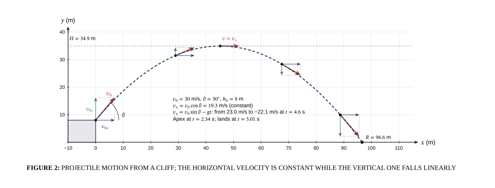

# Projectile motion

## Bill of Materials

| Symbol / ID | Label | Kind | Group | Technical Notes / Metadata |
| :--- | :--- | :--- | :--- | :--- |

## Connections

| Source | Target | Protocol / Label | Style | Routing |
| :--- | :--- | :--- | :--- | :--- |
| **point_3** (`point_3`) | **point_4** (`point_4`) | - | solid | direct |
| **point_5** (`point_5`) | **point_6** (`point_6`) | - | solid | direct |
| **point_33** (`point_33`) | **point_34** (`point_34`) | - | solid | direct |
| **point_35** (`point_35`) | **point_36** (`point_36`) | - | solid | direct |
| **point_39** (`point_39`) | **point_40** (`point_40`) | - | solid | direct |
| **point_42** (`point_42`) | **point_43** (`point_43`) | - | solid | direct |
| **point_44** (`point_44`) | **point_45** (`point_45`) | - | solid | direct |
| **point_48** (`point_48`) | **point_49** (`point_49`) | - | solid | direct |
| **point_51** (`point_51`) | **point_52** (`point_52`) | - | solid | direct |
| **point_54** (`point_54`) | **point_55** (`point_55`) | - | solid | direct |
| **point_56** (`point_56`) | **point_57** (`point_57`) | - | solid | direct |
| **point_60** (`point_60`) | **point_61** (`point_61`) | - | solid | direct |
| **point_63** (`point_63`) | **point_64** (`point_64`) | - | solid | direct |
| **point_65** (`point_65`) | **point_66** (`point_66`) | - | solid | direct |
| **point_69** (`point_69`) | **point_70** (`point_70`) | - | solid | direct |
