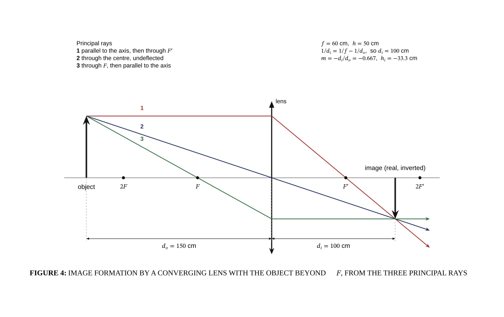

# Thin lens ray diagram

## Bill of Materials

| Symbol / ID | Label | Kind | Group | Technical Notes / Metadata |
| :--- | :--- | :--- | :--- | :--- |

## Connections

| Source | Target | Protocol / Label | Style | Routing |
| :--- | :--- | :--- | :--- | :--- |
| **point_1** (`point_1`) | **point_2** (`point_2`) | - | solid | direct |
| **point_3** (`point_3`) | **point_4** (`point_4`) | - | solid | direct |
| **point_6** (`point_6`) | **point_7** (`point_7`) | - | solid | direct |
| **point_8** (`point_8`) | **point_9** (`point_9`) | - | solid | direct |
| **point_12** (`point_12`) | **point_13** (`point_13`) | - | solid | direct |
| **point_14** (`point_14`) | **point_15** (`point_15`) | - | solid | direct |
| **point_16** (`point_16`) | **point_17** (`point_17`) | - | solid | direct |
| **point_18** (`point_18`) | **point_19** (`point_19`) | - | solid | direct |
| **point_20** (`point_20`) | **point_21** (`point_21`) | - | solid | direct |
| **point_22** (`point_22`) | **point_23** (`point_23`) | - | solid | direct |
| **point_38** (`point_38`) | **point_39** (`point_39`) | - | solid | direct |
| **point_40** (`point_40`) | **point_41** (`point_41`) | - | solid | direct |
