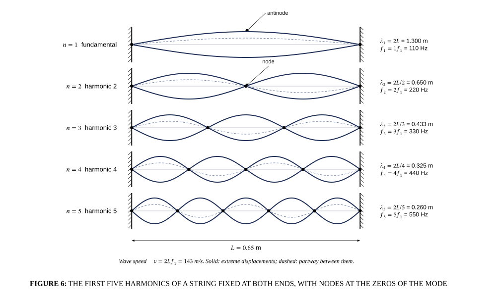

# Standing waves on a string

## Bill of Materials

| Symbol / ID | Label | Kind | Group | Technical Notes / Metadata |
| :--- | :--- | :--- | :--- | :--- |

## Connections

| Source | Target | Protocol / Label | Style | Routing |
| :--- | :--- | :--- | :--- | :--- |
| **point_71** (`point_71`) | **point_72** (`point_72`) | - | solid | direct |
| **antinode** (`text_74`) | **point_75** (`point_75`) | - | solid | direct |
| **node** (`text_76`) | **point_77** (`point_77`) | - | solid | direct |
