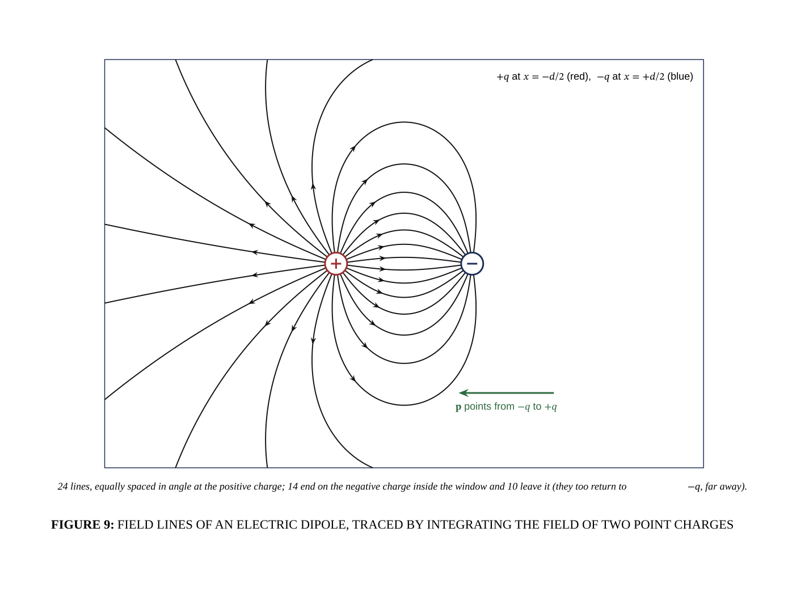

# Electric field lines of a dipole

## Bill of Materials

| Symbol / ID | Label | Kind | Group | Technical Notes / Metadata |
| :--- | :--- | :--- | :--- | :--- |

## Connections

| Source | Target | Protocol / Label | Style | Routing |
| :--- | :--- | :--- | :--- | :--- |
| **point_3** (`point_3`) | **point_4** (`point_4`) | - | solid | direct |
| **point_6** (`point_6`) | **point_7** (`point_7`) | - | solid | direct |
| **point_9** (`point_9`) | **point_10** (`point_10`) | - | solid | direct |
| **point_12** (`point_12`) | **point_13** (`point_13`) | - | solid | direct |
| **point_15** (`point_15`) | **point_16** (`point_16`) | - | solid | direct |
| **point_18** (`point_18`) | **point_19** (`point_19`) | - | solid | direct |
| **point_21** (`point_21`) | **point_22** (`point_22`) | - | solid | direct |
| **point_24** (`point_24`) | **point_25** (`point_25`) | - | solid | direct |
| **point_27** (`point_27`) | **point_28** (`point_28`) | - | solid | direct |
| **point_30** (`point_30`) | **point_31** (`point_31`) | - | solid | direct |
| **point_33** (`point_33`) | **point_34** (`point_34`) | - | solid | direct |
| **point_36** (`point_36`) | **point_37** (`point_37`) | - | solid | direct |
| **point_39** (`point_39`) | **point_40** (`point_40`) | - | solid | direct |
| **point_42** (`point_42`) | **point_43** (`point_43`) | - | solid | direct |
| **point_45** (`point_45`) | **point_46** (`point_46`) | - | solid | direct |
| **point_48** (`point_48`) | **point_49** (`point_49`) | - | solid | direct |
| **point_51** (`point_51`) | **point_52** (`point_52`) | - | solid | direct |
| **point_54** (`point_54`) | **point_55** (`point_55`) | - | solid | direct |
| **point_57** (`point_57`) | **point_58** (`point_58`) | - | solid | direct |
| **point_60** (`point_60`) | **point_61** (`point_61`) | - | solid | direct |
| **point_63** (`point_63`) | **point_64** (`point_64`) | - | solid | direct |
| **point_66** (`point_66`) | **point_67** (`point_67`) | - | solid | direct |
| **point_69** (`point_69`) | **point_70** (`point_70`) | - | solid | direct |
| **point_72** (`point_72`) | **point_73** (`point_73`) | - | solid | direct |
| **point_78** (`point_78`) | **point_79** (`point_79`) | - | solid | direct |
