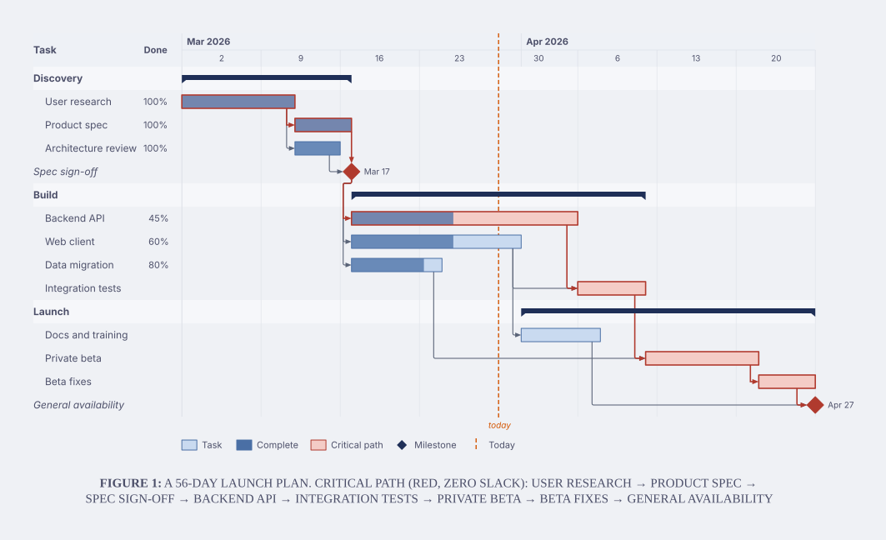

# Launch plan Gantt chart

## Bill of Materials

| Symbol / ID | Label | Kind | Group | Technical Notes / Metadata |
| :--- | :--- | :--- | :--- | :--- |

## Connections

| Source | Target | Protocol / Label | Style | Routing |
| :--- | :--- | :--- | :--- | :--- |
| **research-finish** (`research-finish`) | **arch-start** (`arch-start`) | - | solid | orthogonal |
| **arch-finish** (`arch-finish`) | **signoff-start** (`signoff-start`) | - | solid | orthogonal |
| **signoff-finish** (`signoff-finish`) | **ui-start** (`ui-start`) | - | solid | orthogonal |
| **signoff-finish** (`signoff-finish`) | **data-start** (`data-start`) | - | solid | orthogonal |
| **ui-finish** (`ui-finish`) | **integ-start** (`integ-start`) | - | solid | orthogonal |
| **ui-finish** (`ui-finish`) | **docs-start** (`docs-start`) | - | solid | orthogonal |
| **data-finish** (`data-finish`) | **beta-start** (`beta-start`) | - | solid | orthogonal |
| **docs-finish** (`docs-finish`) | **ga-start** (`ga-start`) | - | solid | orthogonal |
| **research-finish** (`research-finish`) | **spec-start** (`spec-start`) | - | solid | orthogonal |
| **spec-finish** (`spec-finish`) | **signoff-start-2** (`signoff-start-2`) | - | solid | orthogonal |
| **signoff-finish** (`signoff-finish`) | **api-start** (`api-start`) | - | solid | orthogonal |
| **api-finish** (`api-finish`) | **integ-start** (`integ-start`) | - | solid | orthogonal |
| **integ-finish** (`integ-finish`) | **beta-start** (`beta-start`) | - | solid | orthogonal |
| **beta-finish** (`beta-finish`) | **fix-start** (`fix-start`) | - | solid | orthogonal |
| **fix-finish** (`fix-finish`) | **ga-start** (`ga-start`) | - | solid | orthogonal |
