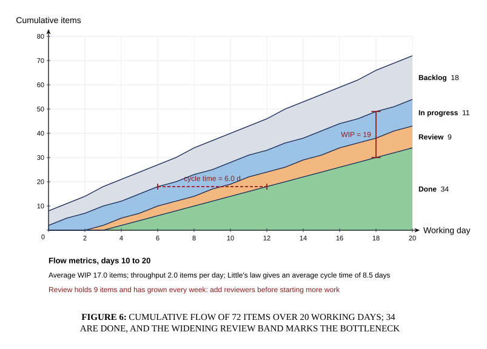

# Cumulative flow diagram

## Bill of Materials

| Symbol / ID | Label | Kind | Group | Technical Notes / Metadata |
| :--- | :--- | :--- | :--- | :--- |

## Connections

| Source | Target | Protocol / Label | Style | Routing |
| :--- | :--- | :--- | :--- | :--- |
| **point_6** (`point_6`) | **point_7** (`point_7`) | - | solid | direct |
| **point_8** (`point_8`) | **point_9** (`point_9`) | - | solid | direct |
