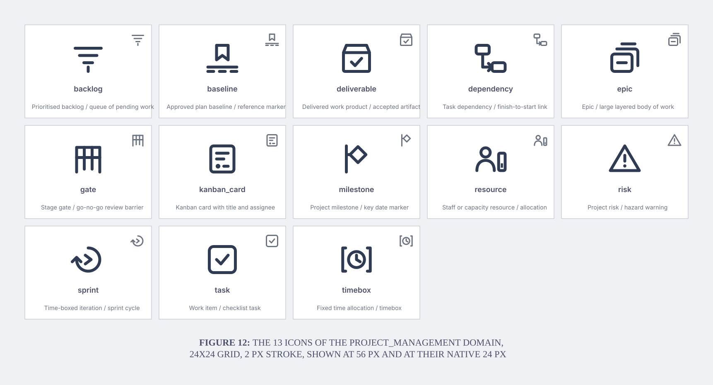

# Project management icon set

## Bill of Materials

| Symbol / ID | Label | Kind | Group | Technical Notes / Metadata |
| :--- | :--- | :--- | :--- | :--- |
| `big_backlog` | **backlog** | icon | - | icon_size: 56, icon_color: #2F3B52 |
| `small_backlog` | **** | icon | - | icon_size: 24, icon_color: #6B7280 |
| `big_baseline` | **baseline** | icon | - | icon_size: 56, icon_color: #2F3B52 |
| `small_baseline` | **** | icon | - | icon_size: 24, icon_color: #6B7280 |
| `big_deliverable` | **deliverable** | icon | - | icon_size: 56, icon_color: #2F3B52 |
| `small_deliverable` | **** | icon | - | icon_size: 24, icon_color: #6B7280 |
| `big_dependency` | **dependency** | icon | - | icon_size: 56, icon_color: #2F3B52 |
| `small_dependency` | **** | icon | - | icon_size: 24, icon_color: #6B7280 |
| `big_epic` | **epic** | icon | - | icon_size: 56, icon_color: #2F3B52 |
| `small_epic` | **** | icon | - | icon_size: 24, icon_color: #6B7280 |
| `big_gate` | **gate** | icon | - | icon_size: 56, icon_color: #2F3B52 |
| `small_gate` | **** | icon | - | icon_size: 24, icon_color: #6B7280 |
| `big_kanban_card` | **kanban_card** | icon | - | icon_size: 56, icon_color: #2F3B52 |
| `small_kanban_card` | **** | icon | - | icon_size: 24, icon_color: #6B7280 |
| `big_milestone` | **milestone** | icon | - | icon_size: 56, icon_color: #2F3B52 |
| `small_milestone` | **** | icon | - | icon_size: 24, icon_color: #6B7280 |
| `big_resource` | **resource** | icon | - | icon_size: 56, icon_color: #2F3B52 |
| `small_resource` | **** | icon | - | icon_size: 24, icon_color: #6B7280 |
| `big_risk` | **risk** | icon | - | icon_size: 56, icon_color: #2F3B52 |
| `small_risk` | **** | icon | - | icon_size: 24, icon_color: #6B7280 |
| `big_sprint` | **sprint** | icon | - | icon_size: 56, icon_color: #2F3B52 |
| `small_sprint` | **** | icon | - | icon_size: 24, icon_color: #6B7280 |
| `big_task` | **task** | icon | - | icon_size: 56, icon_color: #2F3B52 |
| `small_task` | **** | icon | - | icon_size: 24, icon_color: #6B7280 |
| `big_timebox` | **timebox** | icon | - | icon_size: 56, icon_color: #2F3B52 |
| `small_timebox` | **** | icon | - | icon_size: 24, icon_color: #6B7280 |
