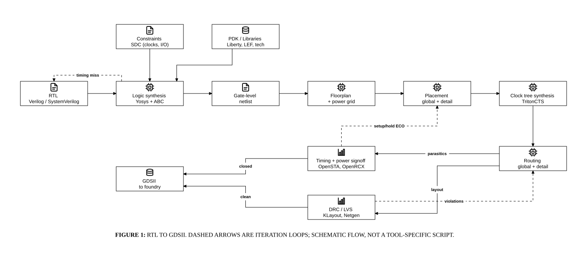

# RTL-to-GDSII Flow (open-source tool names)

## Bill of Materials

| Symbol / ID | Label | Kind | Group | Technical Notes / Metadata |
| :--- | :--- | :--- | :--- | :--- |
| `shape_1` | **Constraints SDC (clocks, I/O)** | box | - | - |
| `shape_2` | **PDK / Libraries Liberty, LEF, tech** | box | - | - |
| `shape_3` | **RTL Verilog / SystemVerilog** | box | - | - |
| `shape_4` | **Logic synthesis Yosys + ABC** | box | - | - |
| `shape_5` | **Gate-level netlist** | box | - | - |
| `shape_6` | **Floorplan + power grid** | box | - | - |
| `shape_7` | **Placement global + detail** | box | - | - |
| `shape_8` | **Clock tree synthesis TritonCTS** | box | - | - |
| `shape_9` | **Routing global + detail** | box | - | - |
| `shape_10` | **Timing + power signoff OpenSTA, OpenRCX** | box | - | - |
| `shape_11` | **DRC / LVS KLayout, Netgen** | box | - | - |
| `shape_12` | **GDSII to foundry** | box | - | - |

## Connections

| Source | Target | Protocol / Label | Style | Routing |
| :--- | :--- | :--- | :--- | :--- |
| **Constraints SDC (clocks, I/O)** (`shape_1`) | **Logic synthesis Yosys + ABC** (`shape_4`) | - | solid | orthogonal |
| **PDK / Libraries Liberty, LEF, tech** (`shape_2`) | **Logic synthesis Yosys + ABC** (`shape_4`) | - | solid | orthogonal |
| **RTL Verilog / SystemVerilog** (`shape_3`) | **Logic synthesis Yosys + ABC** (`shape_4`) | - | solid | orthogonal |
| **Logic synthesis Yosys + ABC** (`shape_4`) | **RTL Verilog / SystemVerilog** (`shape_3`) | timing miss | dashed | orthogonal |
| **Logic synthesis Yosys + ABC** (`shape_4`) | **Gate-level netlist** (`shape_5`) | - | solid | orthogonal |
| **Gate-level netlist** (`shape_5`) | **Floorplan + power grid** (`shape_6`) | - | solid | orthogonal |
| **Floorplan + power grid** (`shape_6`) | **Placement global + detail** (`shape_7`) | - | solid | orthogonal |
| **Placement global + detail** (`shape_7`) | **Clock tree synthesis TritonCTS** (`shape_8`) | - | solid | orthogonal |
| **Clock tree synthesis TritonCTS** (`shape_8`) | **Routing global + detail** (`shape_9`) | - | solid | orthogonal |
| **Routing global + detail** (`shape_9`) | **Timing + power signoff OpenSTA, OpenRCX** (`shape_10`) | parasitics | solid | orthogonal |
| **Routing global + detail** (`shape_9`) | **DRC / LVS KLayout, Netgen** (`shape_11`) | layout | solid | orthogonal |
| **DRC / LVS KLayout, Netgen** (`shape_11`) | **Routing global + detail** (`shape_9`) | violations | dashed | orthogonal |
| **Timing + power signoff OpenSTA, OpenRCX** (`shape_10`) | **Placement global + detail** (`shape_7`) | setup/hold ECO | dashed | orthogonal |
| **Timing + power signoff OpenSTA, OpenRCX** (`shape_10`) | **GDSII to foundry** (`shape_12`) | closed | solid | orthogonal |
| **DRC / LVS KLayout, Netgen** (`shape_11`) | **GDSII to foundry** (`shape_12`) | clean | solid | orthogonal |
