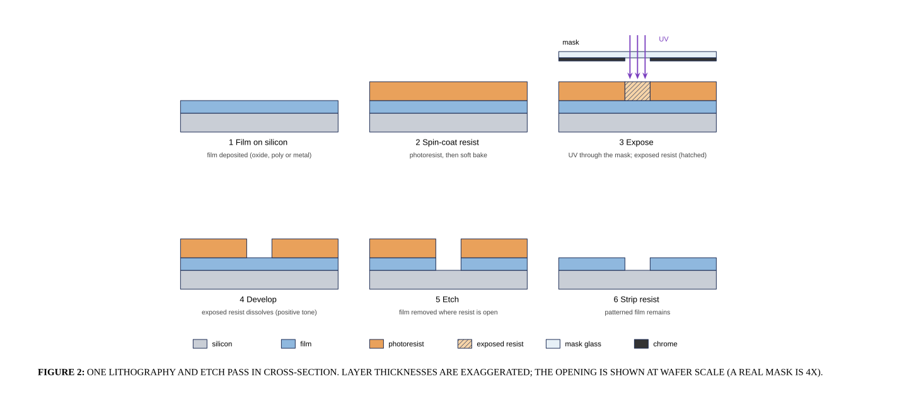

# Photolithography and pattern transfer (schematic cross-sections, not to scale)

## Bill of Materials

| Symbol / ID | Label | Kind | Group | Technical Notes / Metadata |
| :--- | :--- | :--- | :--- | :--- |

## Connections

| Source | Target | Protocol / Label | Style | Routing |
| :--- | :--- | :--- | :--- | :--- |
| **point_21** (`point_21`) | **point_22** (`point_22`) | - | solid | direct |
| **point_23** (`point_23`) | **point_24** (`point_24`) | - | solid | direct |
| **point_25** (`point_25`) | **point_26** (`point_26`) | - | solid | direct |
