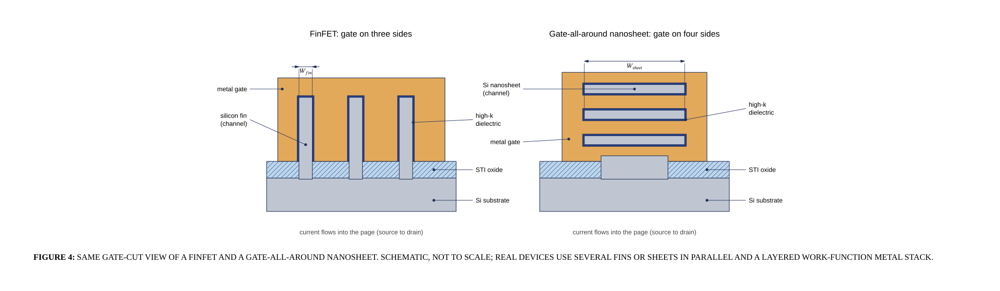

# FinFET vs gate-all-around nanosheet (cross-section through the gate, schematic)

## Bill of Materials

| Symbol / ID | Label | Kind | Group | Technical Notes / Metadata |
| :--- | :--- | :--- | :--- | :--- |
