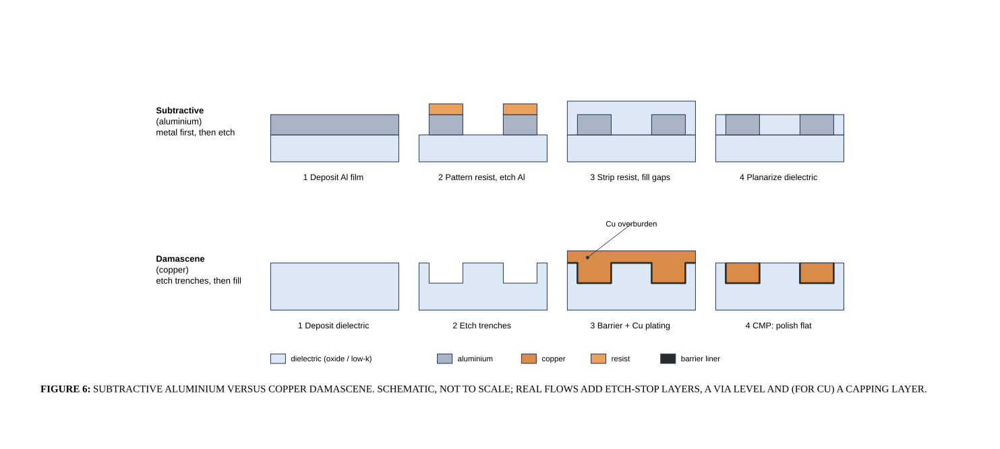

# Subtractive Al vs copper damascene patterning (schematic cross-sections)

## Bill of Materials

| Symbol / ID | Label | Kind | Group | Technical Notes / Metadata |
| :--- | :--- | :--- | :--- | :--- |
