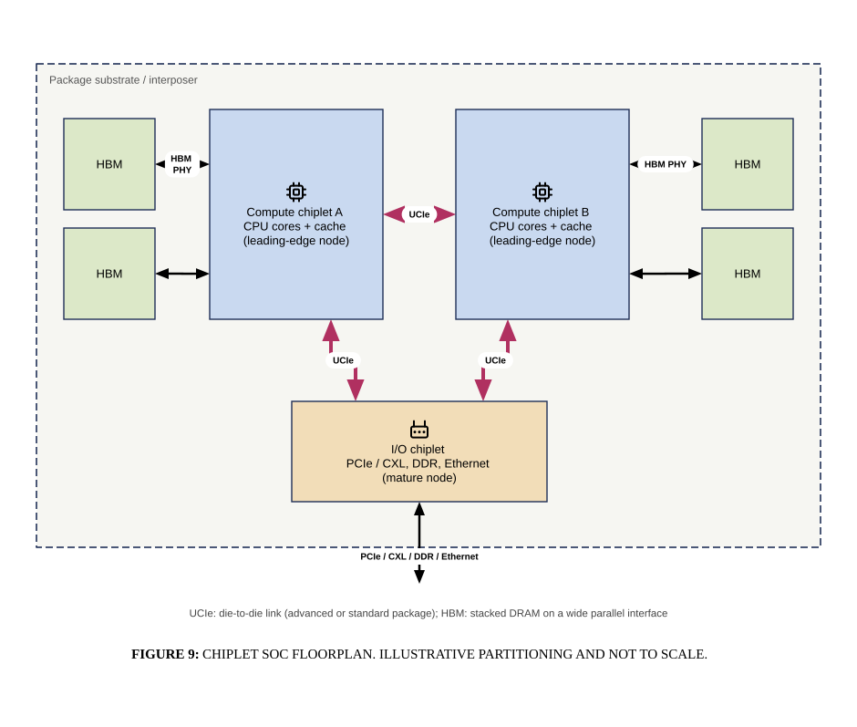

# Chiplet SoC floorplan with UCIe links (schematic, not to scale)

## Bill of Materials

| Symbol / ID | Label | Kind | Group | Technical Notes / Metadata |
| :--- | :--- | :--- | :--- | :--- |
| `shape_3` | **HBM** | box | - | - |
| `shape_4` | **HBM** | box | - | - |
| `shape_5` | **HBM** | box | - | - |
| `shape_6` | **HBM** | box | - | - |
| `shape_7` | **Compute chiplet A CPU cores + cache (leading-edge node)** | box | - | - |
| `shape_8` | **Compute chiplet B CPU cores + cache (leading-edge node)** | box | - | - |
| `shape_9` | **I/O chiplet PCIe / CXL, DDR, Ethernet (mature node)** | box | - | - |

## Connections

| Source | Target | Protocol / Label | Style | Routing |
| :--- | :--- | :--- | :--- | :--- |
| **HBM** (`shape_3`) | **Compute chiplet A CPU cores + cache (leading-edge node)** (`shape_7`) | HBM PHY | solid | orthogonal |
| **HBM** (`shape_4`) | **Compute chiplet A CPU cores + cache (leading-edge node)** (`shape_7`) | - | solid | orthogonal |
| **Compute chiplet B CPU cores + cache (leading-edge node)** (`shape_8`) | **HBM** (`shape_5`) | HBM PHY | solid | orthogonal |
| **Compute chiplet B CPU cores + cache (leading-edge node)** (`shape_8`) | **HBM** (`shape_6`) | - | solid | orthogonal |
| **Compute chiplet A CPU cores + cache (leading-edge node)** (`shape_7`) | **Compute chiplet B CPU cores + cache (leading-edge node)** (`shape_8`) | UCIe | solid | orthogonal |
| **Compute chiplet A CPU cores + cache (leading-edge node)** (`shape_7`) | **I/O chiplet PCIe / CXL, DDR, Ethernet (mature node)** (`shape_9`) | UCIe | solid | orthogonal |
| **Compute chiplet B CPU cores + cache (leading-edge node)** (`shape_8`) | **I/O chiplet PCIe / CXL, DDR, Ethernet (mature node)** (`shape_9`) | UCIe | solid | orthogonal |
| **I/O chiplet PCIe / CXL, DDR, Ethernet (mature node)** (`shape_9`) | **point_10** (`point_10`) | PCIe / CXL / DDR / Ethernet | solid | orthogonal |
