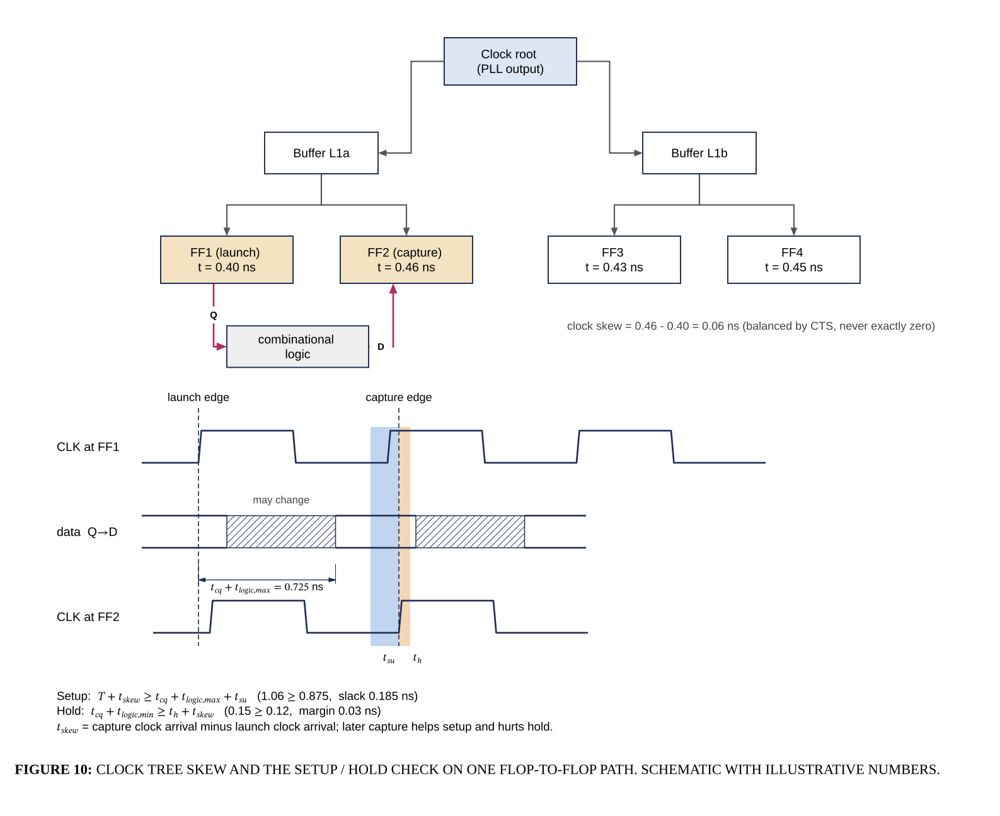

# Clock tree skew and setup / hold timing (schematic, illustrative numbers)

## Bill of Materials

| Symbol / ID | Label | Kind | Group | Technical Notes / Metadata |
| :--- | :--- | :--- | :--- | :--- |
| `shape_1` | **Clock root (PLL output)** | box | - | - |
| `shape_2` | **Buffer L1a** | box | - | - |
| `shape_3` | **Buffer L1b** | box | - | - |
| `shape_4` | **FF1  (launch) t = 0.40 ns** | box | - | - |
| `shape_5` | **FF2  (capture) t = 0.46 ns** | box | - | - |
| `shape_6` | **FF3 t = 0.43 ns** | box | - | - |
| `shape_7` | **FF4 t = 0.45 ns** | box | - | - |
| `shape_8` | **combinational logic** | box | - | - |

## Connections

| Source | Target | Protocol / Label | Style | Routing |
| :--- | :--- | :--- | :--- | :--- |
| **Clock root (PLL output)** (`shape_1`) | **Buffer L1a** (`shape_2`) | - | solid | orthogonal |
| **Clock root (PLL output)** (`shape_1`) | **Buffer L1b** (`shape_3`) | - | solid | orthogonal |
| **Buffer L1a** (`shape_2`) | **FF1  (launch) t = 0.40 ns** (`shape_4`) | - | solid | orthogonal |
| **Buffer L1a** (`shape_2`) | **FF2  (capture) t = 0.46 ns** (`shape_5`) | - | solid | orthogonal |
| **Buffer L1b** (`shape_3`) | **FF3 t = 0.43 ns** (`shape_6`) | - | solid | orthogonal |
| **Buffer L1b** (`shape_3`) | **FF4 t = 0.45 ns** (`shape_7`) | - | solid | orthogonal |
| **FF1  (launch) t = 0.40 ns** (`shape_4`) | **combinational logic** (`shape_8`) | Q | solid | orthogonal |
| **combinational logic** (`shape_8`) | **FF2  (capture) t = 0.46 ns** (`shape_5`) | D | solid | orthogonal |
