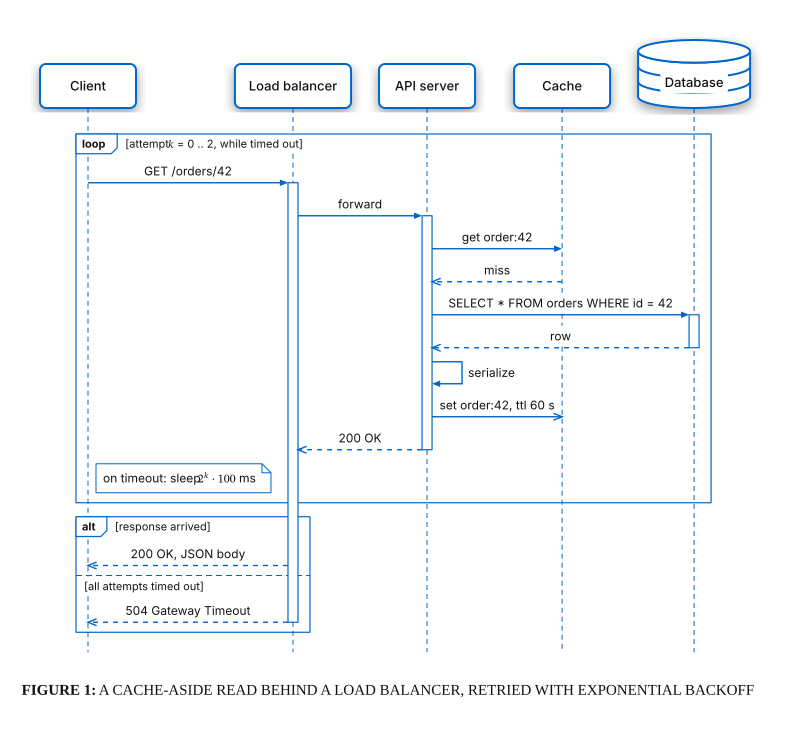

# HTTP request with retry

## Bill of Materials

| Symbol / ID | Label | Kind | Group | Technical Notes / Metadata |
| :--- | :--- | :--- | :--- | :--- |
| `shape_22` | **Client** | box | - | - |
| `shape_23` | **Load balancer** | box | - | - |
| `shape_24` | **API server** | box | - | - |
| `shape_25` | **Cache** | box | - | - |
| `shape_26` | **Database** | database | - | - |

## Connections

| Source | Target | Protocol / Label | Style | Routing |
| :--- | :--- | :--- | :--- | :--- |
| **point_27** (`point_27`) | **point_28** (`point_28`) | - | solid | direct |
| **point_29** (`point_29`) | **point_30** (`point_30`) | - | solid | direct |
| **point_31** (`point_31`) | **point_32** (`point_32`) | - | solid | direct |
| **point_33** (`point_33`) | **point_34** (`point_34`) | - | dashed | direct |
| **point_35** (`point_35`) | **point_36** (`point_36`) | - | solid | direct |
| **point_37** (`point_37`) | **point_38** (`point_38`) | - | dashed | direct |
| **point_39** (`point_39`) | **point_40** (`point_40`) | - | solid | direct |
| **point_41** (`point_41`) | **point_42** (`point_42`) | - | solid | direct |
| **point_43** (`point_43`) | **point_44** (`point_44`) | - | dashed | direct |
| **point_45** (`point_45`) | **point_46** (`point_46`) | - | dashed | direct |
| **point_47** (`point_47`) | **point_48** (`point_48`) | - | dashed | direct |
