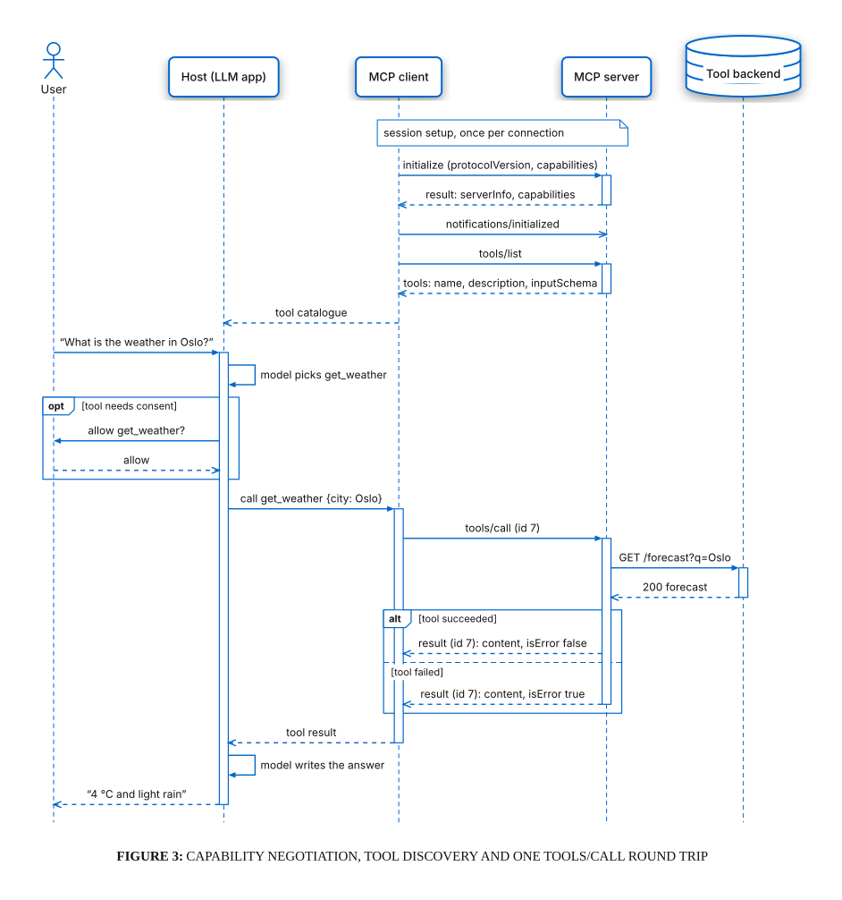

# MCP tool call

## Bill of Materials

| Symbol / ID | Label | Kind | Group | Technical Notes / Metadata |
| :--- | :--- | :--- | :--- | :--- |
| `shape_26` | **Host (LLM app)** | box | - | - |
| `shape_27` | **MCP client** | box | - | - |
| `shape_28` | **MCP server** | box | - | - |
| `shape_29` | **Tool backend** | database | - | - |

## Connections

| Source | Target | Protocol / Label | Style | Routing |
| :--- | :--- | :--- | :--- | :--- |
| **point_30** (`point_30`) | **point_31** (`point_31`) | - | solid | direct |
| **point_32** (`point_32`) | **point_33** (`point_33`) | - | dashed | direct |
| **point_34** (`point_34`) | **point_35** (`point_35`) | - | solid | direct |
| **point_36** (`point_36`) | **point_37** (`point_37`) | - | solid | direct |
| **point_38** (`point_38`) | **point_39** (`point_39`) | - | dashed | direct |
| **point_40** (`point_40`) | **point_41** (`point_41`) | - | dashed | direct |
| **point_42** (`point_42`) | **point_43** (`point_43`) | - | solid | direct |
| **point_44** (`point_44`) | **point_45** (`point_45`) | - | solid | direct |
| **point_46** (`point_46`) | **point_47** (`point_47`) | - | solid | direct |
| **point_48** (`point_48`) | **point_49** (`point_49`) | - | dashed | direct |
| **point_50** (`point_50`) | **point_51** (`point_51`) | - | solid | direct |
| **point_52** (`point_52`) | **point_53** (`point_53`) | - | solid | direct |
| **point_54** (`point_54`) | **point_55** (`point_55`) | - | solid | direct |
| **point_56** (`point_56`) | **point_57** (`point_57`) | - | dashed | direct |
| **point_58** (`point_58`) | **point_59** (`point_59`) | - | dashed | direct |
| **point_60** (`point_60`) | **point_61** (`point_61`) | - | dashed | direct |
| **point_62** (`point_62`) | **point_63** (`point_63`) | - | dashed | direct |
| **point_64** (`point_64`) | **point_65** (`point_65`) | - | solid | direct |
| **point_66** (`point_66`) | **point_67** (`point_67`) | - | dashed | direct |
