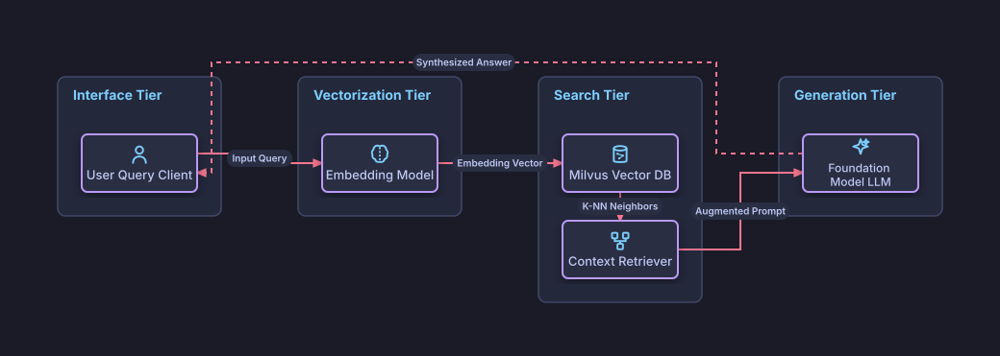

# Simple Retrieval Augmented Generation (RAG)

## Bill of Materials

| Symbol / ID | Label | Kind | Group | Technical Notes / Metadata |
| :--- | :--- | :--- | :--- | :--- |
| `user` | **User Query Client** | box | Interface Tier | channel: Chat UI |
| `embed` | **Embedding Model** | box | Vectorization Tier | model: text-embedding-3-small |
| `vectordb` | **Milvus Vector DB** | box | Search Tier | index: HNSW / Cosine |
| `retriever` | **Context Retriever** | box | Search Tier | top_k: 5 Chunks |
| `llm` | **Foundation Model LLM** | box | Generation Tier | model: Claude 3.5 Sonnet |

## Connections

| Source | Target | Protocol / Label | Style | Routing |
| :--- | :--- | :--- | :--- | :--- |
| **User Query Client** (`user`) | **Embedding Model** (`embed`) | Input Query | solid | orthogonal |
| **Embedding Model** (`embed`) | **Milvus Vector DB** (`vectordb`) | Embedding Vector | solid | orthogonal |
| **Milvus Vector DB** (`vectordb`) | **Context Retriever** (`retriever`) | K-NN Neighbors | solid | orthogonal |
| **Context Retriever** (`retriever`) | **Foundation Model LLM** (`llm`) | Augmented Prompt | solid | orthogonal |
| **Foundation Model LLM** (`llm`) | **User Query Client** (`user`) | Synthesized Answer | dashed | orthogonal |
