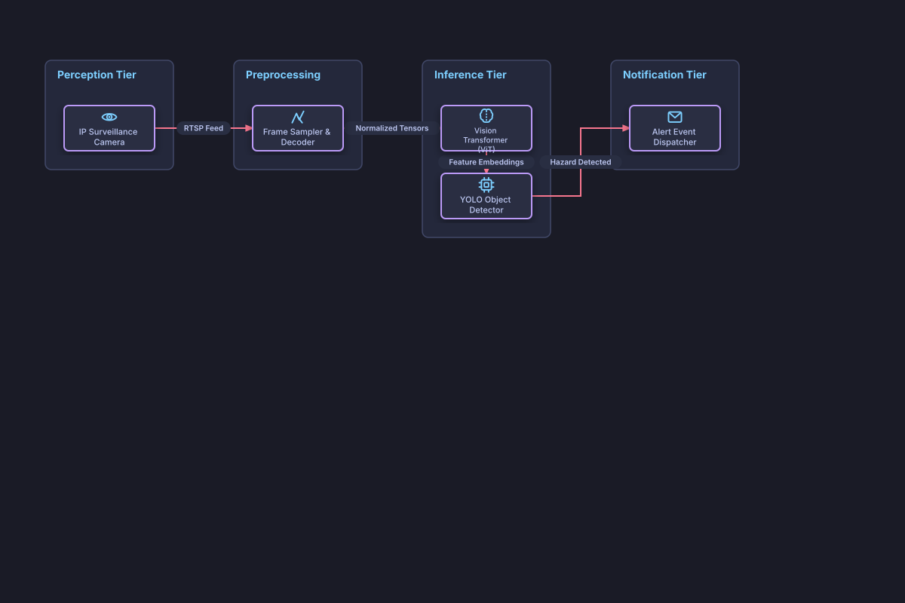

# Multimodal Vision Inference Pipeline

## Bill of Materials

| Symbol / ID | Label | Kind | Group | Technical Notes / Metadata |
| :--- | :--- | :--- | :--- | :--- |
| `cam` | **IP Surveillance Camera** | box | Perception Tier | stream: RTSP 4K 60fps |
| `sampler` | **Frame Sampler & Decoder** | box | Preprocessing | resolution: 1080p 15fps |
| `vit` | **Vision Transformer (ViT)** | box | Inference Tier | backbone: ViT-H/14 |
| `yolo` | **YOLO Object Detector** | box | Inference Tier | framework: TensorRT |
| `alert` | **Alert Event Dispatcher** | box | Notification Tier | webhook: Enterprise Slack / PagerDuty |

## Connections

| Source | Target | Protocol / Label | Style | Routing |
| :--- | :--- | :--- | :--- | :--- |
| **IP Surveillance Camera** (`cam`) | **Frame Sampler & Decoder** (`sampler`) | RTSP Feed | solid | orthogonal |
| **Frame Sampler & Decoder** (`sampler`) | **Vision Transformer (ViT)** (`vit`) | Normalized Tensors | solid | orthogonal |
| **Vision Transformer (ViT)** (`vit`) | **YOLO Object Detector** (`yolo`) | Feature Embeddings | solid | orthogonal |
| **YOLO Object Detector** (`yolo`) | **Alert Event Dispatcher** (`alert`) | Hazard Detected | solid | orthogonal |
