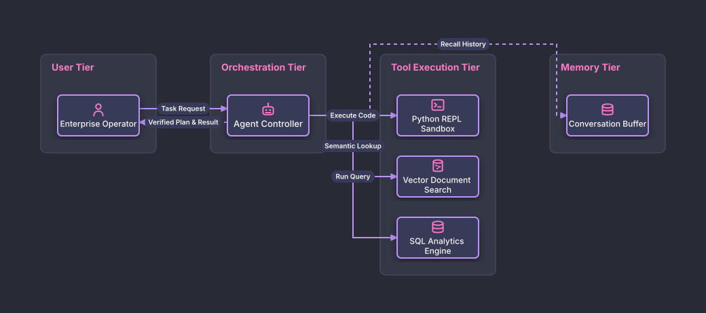

# Autonomous Agent Tool Orchestration

## Bill of Materials

| Symbol / ID | Label | Kind | Group | Technical Notes / Metadata |
| :--- | :--- | :--- | :--- | :--- |
| `user` | **Enterprise Operator** | box | User Tier | auth: SSO RBAC |
| `agent` | **Agent Controller** | box | Orchestration Tier | reasoning: ReAct Loop |
| `tool_repl` | **Python REPL Sandbox** | box | Tool Execution Tier | env: Isolated WASM / gVisor |
| `tool_search` | **Vector Document Search** | box | Tool Execution Tier | engine: Qdrant |
| `tool_sql` | **SQL Analytics Engine** | box | Tool Execution Tier | engine: DuckDB |
| `memory` | **Conversation Buffer** | box | Memory Tier | type: Short-Term / Long-Term |

## Connections

| Source | Target | Protocol / Label | Style | Routing |
| :--- | :--- | :--- | :--- | :--- |
| **Enterprise Operator** (`user`) | **Agent Controller** (`agent`) | Task Request | solid | orthogonal |
| **Agent Controller** (`agent`) | **Conversation Buffer** (`memory`) | Recall History | dashed | orthogonal |
| **Agent Controller** (`agent`) | **Python REPL Sandbox** (`tool_repl`) | Execute Code | solid | orthogonal |
| **Agent Controller** (`agent`) | **Vector Document Search** (`tool_search`) | Semantic Lookup | solid | orthogonal |
| **Agent Controller** (`agent`) | **SQL Analytics Engine** (`tool_sql`) | Run Query | solid | orthogonal |
| **Agent Controller** (`agent`) | **Enterprise Operator** (`user`) | Verified Plan & Result | dashed | orthogonal |
