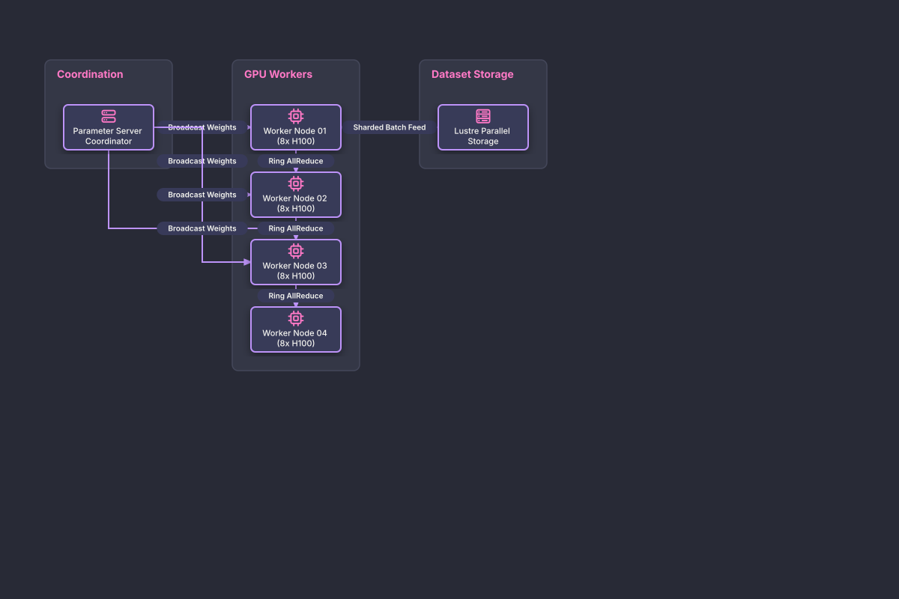

# Distributed Multi-GPU Training Cluster

## Bill of Materials

| Symbol / ID | Label | Kind | Group | Technical Notes / Metadata |
| :--- | :--- | :--- | :--- | :--- |
| `param_server` | **Parameter Server Coordinator** | box | Coordination | framework: Megatron-LM |
| `gpu1` | **Worker Node 01 (8x H100)** | box | GPU Workers | interconnect: NVLink 900GB/s |
| `gpu2` | **Worker Node 02 (8x H100)** | box | GPU Workers | interconnect: NVLink 900GB/s |
| `gpu3` | **Worker Node 03 (8x H100)** | box | GPU Workers | interconnect: NVLink 900GB/s |
| `gpu4` | **Worker Node 04 (8x H100)** | box | GPU Workers | interconnect: NVLink 900GB/s |
| `lustre` | **Lustre Parallel Storage** | box | Dataset Storage | throughput: 2.5 TB/s |

## Connections

| Source | Target | Protocol / Label | Style | Routing |
| :--- | :--- | :--- | :--- | :--- |
| **Parameter Server Coordinator** (`param_server`) | **Worker Node 01 (8x H100)** (`gpu1`) | Broadcast Weights | solid | orthogonal |
| **Parameter Server Coordinator** (`param_server`) | **Worker Node 02 (8x H100)** (`gpu2`) | Broadcast Weights | solid | orthogonal |
| **Parameter Server Coordinator** (`param_server`) | **Worker Node 03 (8x H100)** (`gpu3`) | Broadcast Weights | solid | orthogonal |
| **Parameter Server Coordinator** (`param_server`) | **Worker Node 04 (8x H100)** (`gpu4`) | Broadcast Weights | solid | orthogonal |
| **Worker Node 01 (8x H100)** (`gpu1`) | **Worker Node 02 (8x H100)** (`gpu2`) | Ring AllReduce | dashed | orthogonal |
| **Worker Node 02 (8x H100)** (`gpu2`) | **Worker Node 03 (8x H100)** (`gpu3`) | Ring AllReduce | dashed | orthogonal |
| **Worker Node 03 (8x H100)** (`gpu3`) | **Worker Node 04 (8x H100)** (`gpu4`) | Ring AllReduce | dashed | orthogonal |
| **Lustre Parallel Storage** (`lustre`) | **Worker Node 01 (8x H100)** (`gpu1`) | Sharded Batch Feed | solid | orthogonal |
