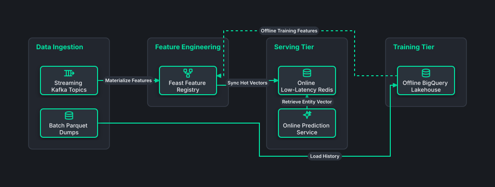

# Enterprise Feature Store & MLOps Pipeline

## Bill of Materials

| Symbol / ID | Label | Kind | Group | Technical Notes / Metadata |
| :--- | :--- | :--- | :--- | :--- |
| `stream_in` | **Streaming Kafka Topics** | box | Data Ingestion | rate: 250,000 evt/s |
| `batch_in` | **Batch Parquet Dumps** | box | Data Ingestion | frequency: Hourly ETL |
| `feast` | **Feast Feature Registry** | box | Feature Engineering | schema: Protobuf Definitions |
| `redis_online` | **Online Low-Latency Redis** | box | Serving Tier | latency: <2ms P99 |
| `model_svc` | **Online Prediction Service** | box | Serving Tier | framework: Triton Server |
| `warehouse` | **Offline BigQuery Lakehouse** | box | Training Tier | retention: 3 Years |

## Connections

| Source | Target | Protocol / Label | Style | Routing |
| :--- | :--- | :--- | :--- | :--- |
| **Streaming Kafka Topics** (`stream_in`) | **Feast Feature Registry** (`feast`) | Materialize Features | solid | orthogonal |
| **Batch Parquet Dumps** (`batch_in`) | **Offline BigQuery Lakehouse** (`warehouse`) | Load History | solid | orthogonal |
| **Feast Feature Registry** (`feast`) | **Online Low-Latency Redis** (`redis_online`) | Sync Hot Vectors | solid | orthogonal |
| **Online Prediction Service** (`model_svc`) | **Online Low-Latency Redis** (`redis_online`) | Retrieve Entity Vector | solid | orthogonal |
| **Offline BigQuery Lakehouse** (`warehouse`) | **Feast Feature Registry** (`feast`) | Offline Training Features | dashed | orthogonal |
