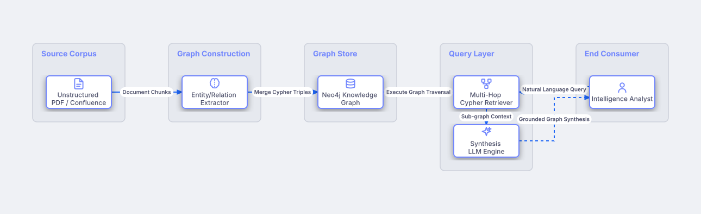

# GraphRAG & Knowledge Graph Augmented LLM

## Bill of Materials

| Symbol / ID | Label | Kind | Group | Technical Notes / Metadata |
| :--- | :--- | :--- | :--- | :--- |
| `raw_corpus` | **Unstructured PDF / Confluence** | box | Source Corpus | volume: 100,000 Documents |
| `extractor` | **Entity/Relation Extractor** | box | Graph Construction | model: GPT-4o NER |
| `neo4j` | **Neo4j Knowledge Graph** | box | Graph Store | nodes: 2M Entities, 8M Edges |
| `graph_retriever` | **Multi-Hop Cypher Retriever** | box | Query Layer | hops: 3-Hop Expansion |
| `synth_llm` | **Synthesis LLM Engine** | box | Query Layer | prompt: Graph Context Injected |
| `analyst` | **Intelligence Analyst** | box | End Consumer | role: Investigative Research |

## Connections

| Source | Target | Protocol / Label | Style | Routing |
| :--- | :--- | :--- | :--- | :--- |
| **Unstructured PDF / Confluence** (`raw_corpus`) | **Entity/Relation Extractor** (`extractor`) | Document Chunks | solid | orthogonal |
| **Entity/Relation Extractor** (`extractor`) | **Neo4j Knowledge Graph** (`neo4j`) | Merge Cypher Triples | solid | orthogonal |
| **Intelligence Analyst** (`analyst`) | **Multi-Hop Cypher Retriever** (`graph_retriever`) | Natural Language Query | solid | orthogonal |
| **Multi-Hop Cypher Retriever** (`graph_retriever`) | **Neo4j Knowledge Graph** (`neo4j`) | Execute Graph Traversal | solid | orthogonal |
| **Multi-Hop Cypher Retriever** (`graph_retriever`) | **Synthesis LLM Engine** (`synth_llm`) | Sub-graph Context | solid | orthogonal |
| **Synthesis LLM Engine** (`synth_llm`) | **Intelligence Analyst** (`analyst`) | Grounded Graph Synthesis | dashed | orthogonal |
