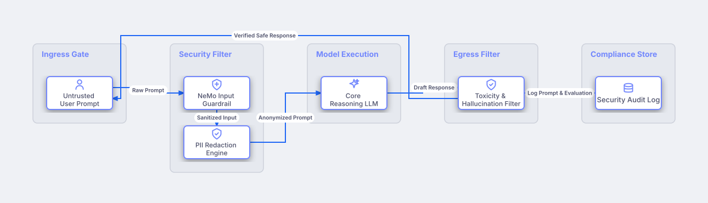

# AI Safety Guardrails & Jailbreak Defense

## Bill of Materials

| Symbol / ID | Label | Kind | Group | Technical Notes / Metadata |
| :--- | :--- | :--- | :--- | :--- |
| `user_input` | **Untrusted User Prompt** | box | Ingress Gate | risk: Potential Jailbreak |
| `guard_in` | **NeMo Input Guardrail** | box | Security Filter | check: Prompt Injection / Jailbreak |
| `pii_mask` | **PII Redaction Engine** | box | Security Filter | compliance: HIPAA / GDPR |
| `llm_core` | **Core Reasoning LLM** | box | Model Execution | temperature: 0.2 |
| `guard_out` | **Toxicity & Hallucination Filter** | box | Egress Filter | metric: Faithfulness Score |
| `audit_log` | **Security Audit Log** | box | Compliance Store | retention: 7 Years Immutable |

## Connections

| Source | Target | Protocol / Label | Style | Routing |
| :--- | :--- | :--- | :--- | :--- |
| **Untrusted User Prompt** (`user_input`) | **NeMo Input Guardrail** (`guard_in`) | Raw Prompt | solid | orthogonal |
| **NeMo Input Guardrail** (`guard_in`) | **PII Redaction Engine** (`pii_mask`) | Sanitized Input | solid | orthogonal |
| **PII Redaction Engine** (`pii_mask`) | **Core Reasoning LLM** (`llm_core`) | Anonymized Prompt | solid | orthogonal |
| **Core Reasoning LLM** (`llm_core`) | **Toxicity & Hallucination Filter** (`guard_out`) | Draft Response | solid | orthogonal |
| **Toxicity & Hallucination Filter** (`guard_out`) | **Security Audit Log** (`audit_log`) | Log Prompt & Evaluation | dashed | orthogonal |
| **Toxicity & Hallucination Filter** (`guard_out`) | **Untrusted User Prompt** (`user_input`) | Verified Safe Response | solid | orthogonal |
