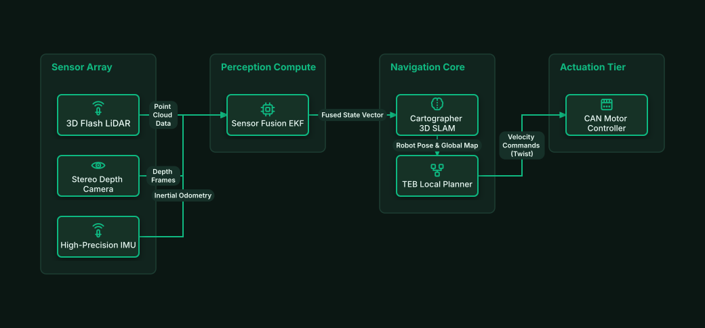

# Autonomous Mobile Robot (AMR) SLAM Engine

## Bill of Materials

| Symbol / ID | Label | Kind | Group | Technical Notes / Metadata |
| :--- | :--- | :--- | :--- | :--- |
| `lidar` | **3D Flash LiDAR** | box | Sensor Array | frequency: 20Hz 128-Beam |
| `camera` | **Stereo Depth Camera** | box | Sensor Array | fov: 120 Degree FOV |
| `imu` | **High-Precision IMU** | box | Sensor Array | axes: 6-DOF Accelerometer/Gyro |
| `ekf` | **Sensor Fusion EKF** | box | Perception Compute | algorithm: Extended Kalman Filter |
| `slam` | **Cartographer 3D SLAM** | box | Navigation Core | map: Occupancy Grid Map |
| `planner` | **TEB Local Planner** | box | Navigation Core | obstacle_avoidance: Dynamic |
| `motors` | **CAN Motor Controller** | box | Actuation Tier | bus: CANopen 1Mbps |

## Connections

| Source | Target | Protocol / Label | Style | Routing |
| :--- | :--- | :--- | :--- | :--- |
| **3D Flash LiDAR** (`lidar`) | **Sensor Fusion EKF** (`ekf`) | Point Cloud Data | solid | orthogonal |
| **Stereo Depth Camera** (`camera`) | **Sensor Fusion EKF** (`ekf`) | Depth Frames | solid | orthogonal |
| **High-Precision IMU** (`imu`) | **Sensor Fusion EKF** (`ekf`) | Inertial Odometry | solid | orthogonal |
| **Sensor Fusion EKF** (`ekf`) | **Cartographer 3D SLAM** (`slam`) | Fused State Vector | solid | orthogonal |
| **Cartographer 3D SLAM** (`slam`) | **TEB Local Planner** (`planner`) | Robot Pose & Global Map | solid | orthogonal |
| **TEB Local Planner** (`planner`) | **CAN Motor Controller** (`motors`) | Velocity Commands (Twist) | solid | orthogonal |
