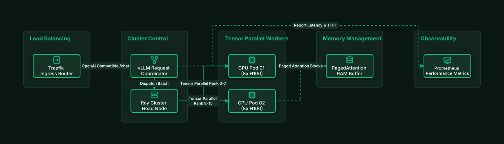

# Self-Hosted vLLM Ray Cluster with PagedAttention

## Bill of Materials

| Symbol / ID | Label | Kind | Group | Technical Notes / Metadata |
| :--- | :--- | :--- | :--- | :--- |
| `ingress_lb` | **Traefik Ingress Router** | box | Load Balancing | rate_limiting: Token Bucket |
| `vllm_router` | **vLLM Request Coordinator** | box | Cluster Control | scheduling: Continuous Batching |
| `ray_head` | **Ray Cluster Head Node** | box | Cluster Control | nodes: 4 Worker Pods |
| `worker1` | **GPU Pod 01 (8x H100)** | box | Tensor Parallel Workers | tp: TP=8 / FP8 Cache |
| `worker2` | **GPU Pod 02 (8x H100)** | box | Tensor Parallel Workers | tp: TP=8 / FP8 Cache |
| `kv_cache` | **PagedAttention RAM Buffer** | box | Memory Management | allocation: Dynamic Block Pool |
| `metrics` | **Prometheus Performance Metrics** | box | Observability | kpi: Tokens/sec, TTFT, ITL |

## Connections

| Source | Target | Protocol / Label | Style | Routing |
| :--- | :--- | :--- | :--- | :--- |
| **Traefik Ingress Router** (`ingress_lb`) | **vLLM Request Coordinator** (`vllm_router`) | OpenAI Compatible /chat | solid | orthogonal |
| **vLLM Request Coordinator** (`vllm_router`) | **Ray Cluster Head Node** (`ray_head`) | Dispatch Batch | solid | orthogonal |
| **Ray Cluster Head Node** (`ray_head`) | **GPU Pod 01 (8x H100)** (`worker1`) | Tensor Parallel Rank 0-7 | solid | orthogonal |
| **Ray Cluster Head Node** (`ray_head`) | **GPU Pod 02 (8x H100)** (`worker2`) | Tensor Parallel Rank 8-15 | solid | orthogonal |
| **GPU Pod 01 (8x H100)** (`worker1`) | **PagedAttention RAM Buffer** (`kv_cache`) | Paged Attention Blocks | dashed | orthogonal |
| **GPU Pod 02 (8x H100)** (`worker2`) | **PagedAttention RAM Buffer** (`kv_cache`) | Paged Attention Blocks | dashed | orthogonal |
| **vLLM Request Coordinator** (`vllm_router`) | **Prometheus Performance Metrics** (`metrics`) | Report Latency & TTFT | dashed | orthogonal |
