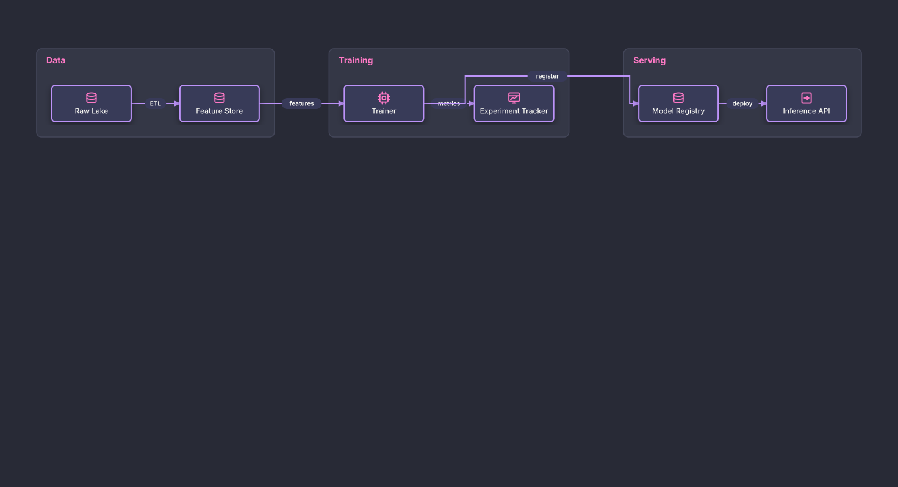

# Auto-Laid-Out Training Pipeline

## Bill of Materials

| Symbol / ID | Label | Kind | Group | Technical Notes / Metadata |
| :--- | :--- | :--- | :--- | :--- |
| `shape_2` | **Raw Lake** | box | Data | - |
| `shape_3` | **Feature Store** | box | Data | - |
| `shape_5` | **Trainer** | box | Training | - |
| `shape_6` | **Experiment Tracker** | box | Training | - |
| `shape_8` | **Model Registry** | box | Serving | - |
| `shape_9` | **Inference API** | box | Serving | - |

## Connections

| Source | Target | Protocol / Label | Style | Routing |
| :--- | :--- | :--- | :--- | :--- |
| **Raw Lake** (`shape_2`) | **Feature Store** (`shape_3`) | ETL | solid | orthogonal |
| **Feature Store** (`shape_3`) | **Trainer** (`shape_5`) | features | solid | orthogonal |
| **Trainer** (`shape_5`) | **Experiment Tracker** (`shape_6`) | metrics | solid | orthogonal |
| **Trainer** (`shape_5`) | **Model Registry** (`shape_8`) | register | solid | orthogonal |
| **Model Registry** (`shape_8`) | **Inference API** (`shape_9`) | deploy | solid | orthogonal |
