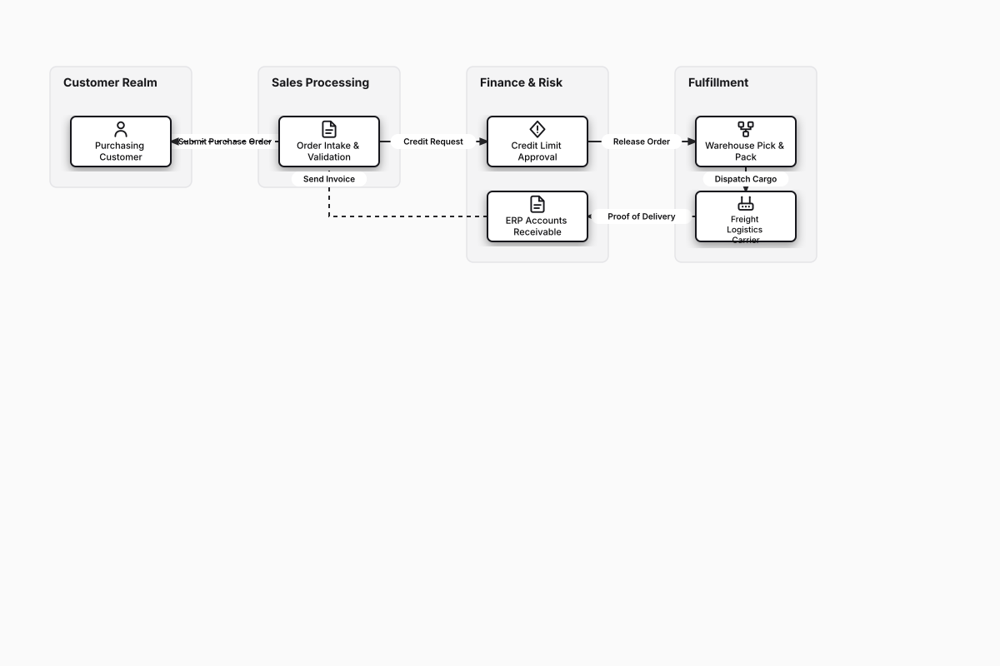

# Order-to-Cash (O2C) Business Process

## Bill of Materials

| Symbol / ID | Label | Kind | Group | Technical Notes / Metadata |
| :--- | :--- | :--- | :--- | :--- |
| `customer` | **Purchasing Customer** | box | Customer Realm | channel: B2B Ecommerce |
| `order_entry` | **Order Intake & Validation** | box | Sales Processing | validation: SKU Availability |
| `credit_check` | **Credit Limit Approval** | box | Finance & Risk | rule: Automated Scorecard |
| `invoice` | **ERP Accounts Receivable** | box | Finance & Risk | terms: Net 30 Invoicing |
| `warehouse` | **Warehouse Pick & Pack** | box | Fulfillment | wms: Robotic Automated Storage |
| `shipping` | **Freight Logistics Carrier** | box | Fulfillment | tracking: EDI 214 Carrier Status |

## Connections

| Source | Target | Protocol / Label | Style | Routing |
| :--- | :--- | :--- | :--- | :--- |
| **Purchasing Customer** (`customer`) | **Order Intake & Validation** (`order_entry`) | Submit Purchase Order | solid | orthogonal |
| **Order Intake & Validation** (`order_entry`) | **Credit Limit Approval** (`credit_check`) | Credit Request | solid | orthogonal |
| **Credit Limit Approval** (`credit_check`) | **Warehouse Pick & Pack** (`warehouse`) | Release Order | solid | orthogonal |
| **Warehouse Pick & Pack** (`warehouse`) | **Freight Logistics Carrier** (`shipping`) | Dispatch Cargo | solid | orthogonal |
| **Freight Logistics Carrier** (`shipping`) | **ERP Accounts Receivable** (`invoice`) | Proof of Delivery | solid | orthogonal |
| **ERP Accounts Receivable** (`invoice`) | **Purchasing Customer** (`customer`) | Send Invoice | dashed | orthogonal |
