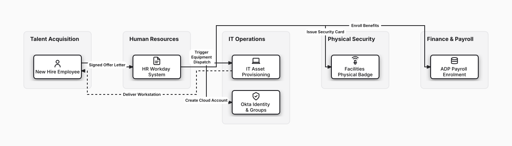

# Corporate Employee Onboarding Lifecycle

## Bill of Materials

| Symbol / ID | Label | Kind | Group | Technical Notes / Metadata |
| :--- | :--- | :--- | :--- | :--- |
| `candidate` | **New Hire Employee** | box | Talent Acquisition | role: Software Engineer |
| `hr_intake` | **HR Workday System** | box | Human Resources | record: Employee ID Creation |
| `it_provision` | **IT Asset Provisioning** | box | IT Operations | device: MacBook Pro + YubiKey |
| `iam_setup` | **Okta Identity & Groups** | box | IT Operations | rbac: Engineering Team Role |
| `badge_access` | **Facilities Physical Badge** | box | Physical Security | zones: HQ Access Granted |
| `payroll` | **ADP Payroll Enrolment** | box | Finance & Payroll | direct_deposit: Active |

## Connections

| Source | Target | Protocol / Label | Style | Routing |
| :--- | :--- | :--- | :--- | :--- |
| **New Hire Employee** (`candidate`) | **HR Workday System** (`hr_intake`) | Signed Offer Letter | solid | orthogonal |
| **HR Workday System** (`hr_intake`) | **IT Asset Provisioning** (`it_provision`) | Trigger Equipment Dispatch | solid | orthogonal |
| **HR Workday System** (`hr_intake`) | **Okta Identity & Groups** (`iam_setup`) | Create Cloud Account | solid | orthogonal |
| **HR Workday System** (`hr_intake`) | **Facilities Physical Badge** (`badge_access`) | Issue Security Card | solid | orthogonal |
| **HR Workday System** (`hr_intake`) | **ADP Payroll Enrolment** (`payroll`) | Enroll Benefits | solid | orthogonal |
| **IT Asset Provisioning** (`it_provision`) | **New Hire Employee** (`candidate`) | Deliver Workstation | dashed | orthogonal |
