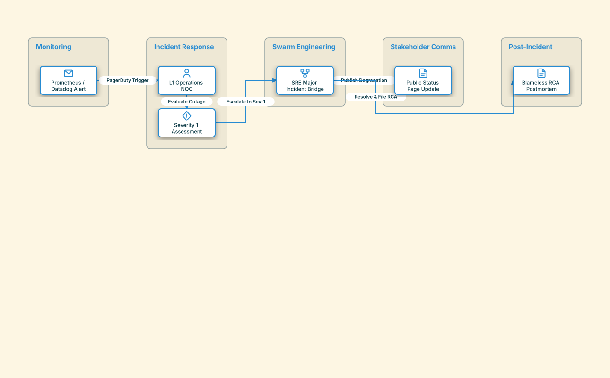

# ITSM Major Incident Escalation & Response

## Bill of Materials

| Symbol / ID | Label | Kind | Group | Technical Notes / Metadata |
| :--- | :--- | :--- | :--- | :--- |
| `alert_source` | **Prometheus / Datadog Alert** | box | Monitoring | threshold: API Error Rate > 5% |
| `l1_triage` | **L1 Operations NOC** | box | Incident Response | sla: 5 min Response |
| `decision_gate` | **Severity 1 Assessment** | box | Incident Response | criteria: Revenue Impacting |
| `war_room` | **SRE Major Incident Bridge** | box | Swarm Engineering | bridge: Zoom Incident Command |
| `status_page` | **Public Status Page Update** | box | Stakeholder Comms | comms: status.company.com |
| `postmortem` | **Blameless RCA Postmortem** | box | Post-Incident | template: Corrective Action Plan |

## Connections

| Source | Target | Protocol / Label | Style | Routing |
| :--- | :--- | :--- | :--- | :--- |
| **Prometheus / Datadog Alert** (`alert_source`) | **L1 Operations NOC** (`l1_triage`) | PagerDuty Trigger | solid | orthogonal |
| **L1 Operations NOC** (`l1_triage`) | **Severity 1 Assessment** (`decision_gate`) | Evaluate Outage | solid | orthogonal |
| **Severity 1 Assessment** (`decision_gate`) | **SRE Major Incident Bridge** (`war_room`) | Escalate to Sev-1 | solid | orthogonal |
| **SRE Major Incident Bridge** (`war_room`) | **Public Status Page Update** (`status_page`) | Publish Degradation | dashed | orthogonal |
| **SRE Major Incident Bridge** (`war_room`) | **Blameless RCA Postmortem** (`postmortem`) | Resolve & File RCA | solid | orthogonal |
