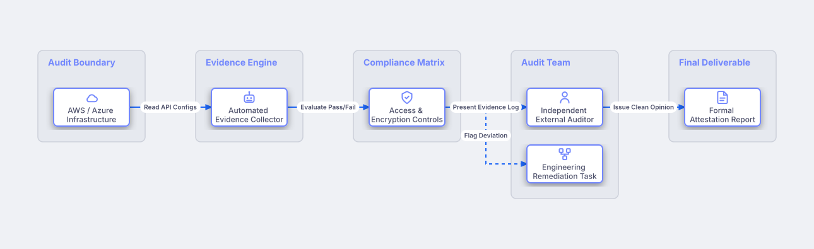

# Continuous SOC2 & ISO 27001 Audit Process

## Bill of Materials

| Symbol / ID | Label | Kind | Group | Technical Notes / Metadata |
| :--- | :--- | :--- | :--- | :--- |
| `cloud_env` | **AWS / Azure Infrastructure** | box | Audit Boundary | accounts: 12 Production Accounts |
| `evidence_bot` | **Automated Evidence Collector** | box | Evidence Engine | engine: Vanta / Drata |
| `sec_controls` | **Access & Encryption Controls** | box | Compliance Matrix | framework: SOC 2 Type II |
| `auditor` | **Independent External Auditor** | box | Audit Team | firm: Big 4 Accounting Firm |
| `remediation` | **Engineering Remediation Task** | box | Audit Team | ticket: Jira Security Task |
| `attestation` | **Formal Attestation Report** | box | Final Deliverable | validity: 12 Months |

## Connections

| Source | Target | Protocol / Label | Style | Routing |
| :--- | :--- | :--- | :--- | :--- |
| **AWS / Azure Infrastructure** (`cloud_env`) | **Automated Evidence Collector** (`evidence_bot`) | Read API Configs | solid | orthogonal |
| **Automated Evidence Collector** (`evidence_bot`) | **Access & Encryption Controls** (`sec_controls`) | Evaluate Pass/Fail | solid | orthogonal |
| **Access & Encryption Controls** (`sec_controls`) | **Independent External Auditor** (`auditor`) | Present Evidence Log | solid | orthogonal |
| **Access & Encryption Controls** (`sec_controls`) | **Engineering Remediation Task** (`remediation`) | Flag Deviation | dashed | orthogonal |
| **Independent External Auditor** (`auditor`) | **Formal Attestation Report** (`attestation`) | Issue Clean Opinion | solid | orthogonal |
