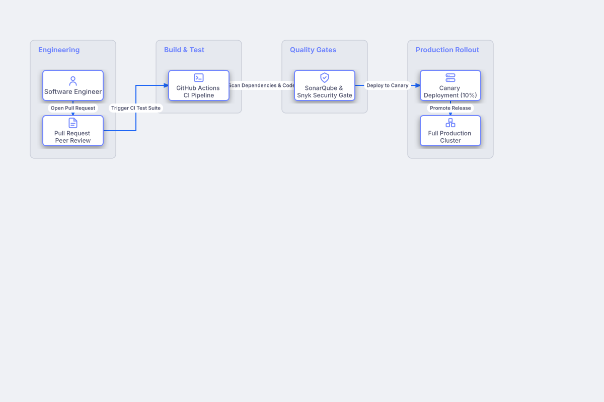

# Continuous Deployment & Release Gating

## Bill of Materials

| Symbol / ID | Label | Kind | Group | Technical Notes / Metadata |
| :--- | :--- | :--- | :--- | :--- |
| `developer` | **Software Engineer** | box | Engineering | git: feature-branch |
| `pr_merge` | **Pull Request Peer Review** | box | Engineering | approvals: 2 Senior Engineers |
| `ci_runner` | **GitHub Actions CI Pipeline** | box | Build & Test | matrix: Tests & Linting |
| `sast_gate` | **SonarQube & Snyk Security Gate** | box | Quality Gates | threshold: Zero High Vulnerabilities |
| `canary` | **Canary Deployment (10%)** | box | Production Rollout | duration: 1 Hour Bake |
| `prod_fleet` | **Full Production Cluster** | box | Production Rollout | traffic: 100% Live Users |

## Connections

| Source | Target | Protocol / Label | Style | Routing |
| :--- | :--- | :--- | :--- | :--- |
| **Software Engineer** (`developer`) | **Pull Request Peer Review** (`pr_merge`) | Open Pull Request | solid | orthogonal |
| **Pull Request Peer Review** (`pr_merge`) | **GitHub Actions CI Pipeline** (`ci_runner`) | Trigger CI Test Suite | solid | orthogonal |
| **GitHub Actions CI Pipeline** (`ci_runner`) | **SonarQube & Snyk Security Gate** (`sast_gate`) | Scan Dependencies & Code | solid | orthogonal |
| **SonarQube & Snyk Security Gate** (`sast_gate`) | **Canary Deployment (10%)** (`canary`) | Deploy to Canary | solid | orthogonal |
| **Canary Deployment (10%)** (`canary`) | **Full Production Cluster** (`prod_fleet`) | Promote Release | solid | orthogonal |
