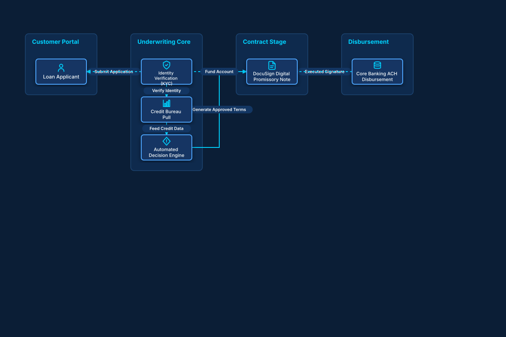

# Digital Consumer Loan Origination

## Bill of Materials

| Symbol / ID | Label | Kind | Group | Technical Notes / Metadata |
| :--- | :--- | :--- | :--- | :--- |
| `applicant` | **Loan Applicant** | box | Customer Portal | credit: Consumer Retail |
| `kyc_aml` | **Identity Verification (KYC)** | box | Underwriting Core | api: Socure / Persona |
| `credit_score` | **Credit Bureau Pull** | box | Underwriting Core | bureau: FICO 8 Pull |
| `rule_engine` | **Automated Decision Engine** | box | Underwriting Core | dti: Max 40% Debt-to-Income |
| `esign` | **DocuSign Digital Promissory Note** | box | Contract Stage | signature: Cryptographic E-Sign |
| `ach_wire` | **Core Banking ACH Disbursement** | box | Disbursement | rail: Same-Day ACH |

## Connections

| Source | Target | Protocol / Label | Style | Routing |
| :--- | :--- | :--- | :--- | :--- |
| **Loan Applicant** (`applicant`) | **Identity Verification (KYC)** (`kyc_aml`) | Submit Application | solid | orthogonal |
| **Identity Verification (KYC)** (`kyc_aml`) | **Credit Bureau Pull** (`credit_score`) | Verify Identity | solid | orthogonal |
| **Credit Bureau Pull** (`credit_score`) | **Automated Decision Engine** (`rule_engine`) | Feed Credit Data | solid | orthogonal |
| **Automated Decision Engine** (`rule_engine`) | **DocuSign Digital Promissory Note** (`esign`) | Generate Approved Terms | solid | orthogonal |
| **DocuSign Digital Promissory Note** (`esign`) | **Core Banking ACH Disbursement** (`ach_wire`) | Executed Signature | solid | orthogonal |
| **Core Banking ACH Disbursement** (`ach_wire`) | **Loan Applicant** (`applicant`) | Fund Account | dashed | orthogonal |
