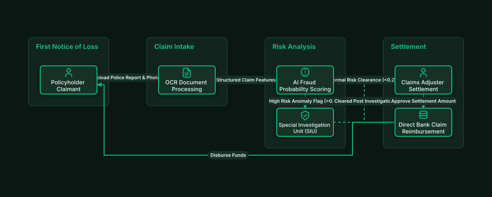

# Insurance Claims Processing & AI Fraud Scoring

## Bill of Materials

| Symbol / ID | Label | Kind | Group | Technical Notes / Metadata |
| :--- | :--- | :--- | :--- | :--- |
| `claimant` | **Policyholder Claimant** | box | First Notice of Loss | type: Auto Accident Claim |
| `ocr_docs` | **OCR Document Processing** | box | Claim Intake | engine: AWS Textract |
| `fraud_ai` | **AI Fraud Probability Scoring** | box | Risk Analysis | model: XGBoost Anomaly Model |
| `siu_review` | **Special Investigation Unit (SIU)** | box | Risk Analysis | action: Manual Forensic Audit |
| `adjuster` | **Claims Adjuster Settlement** | box | Settlement | authority: Authorized Settlement |
| `payment` | **Direct Bank Claim Reimbursement** | box | Settlement | rail: Instant Push-to-Card |

## Connections

| Source | Target | Protocol / Label | Style | Routing |
| :--- | :--- | :--- | :--- | :--- |
| **Policyholder Claimant** (`claimant`) | **OCR Document Processing** (`ocr_docs`) | Upload Police Report & Photos | solid | orthogonal |
| **OCR Document Processing** (`ocr_docs`) | **AI Fraud Probability Scoring** (`fraud_ai`) | Structured Claim Features | solid | orthogonal |
| **AI Fraud Probability Scoring** (`fraud_ai`) | **Special Investigation Unit (SIU)** (`siu_review`) | High Risk Anomaly Flag (>0.85) | dashed | orthogonal |
| **AI Fraud Probability Scoring** (`fraud_ai`) | **Claims Adjuster Settlement** (`adjuster`) | Normal Risk Clearance (<0.20) | solid | orthogonal |
| **Special Investigation Unit (SIU)** (`siu_review`) | **Claims Adjuster Settlement** (`adjuster`) | Cleared Post Investigation | dashed | orthogonal |
| **Claims Adjuster Settlement** (`adjuster`) | **Direct Bank Claim Reimbursement** (`payment`) | Approve Settlement Amount | solid | orthogonal |
| **Direct Bank Claim Reimbursement** (`payment`) | **Policyholder Claimant** (`claimant`) | Disburse Funds | solid | orthogonal |
