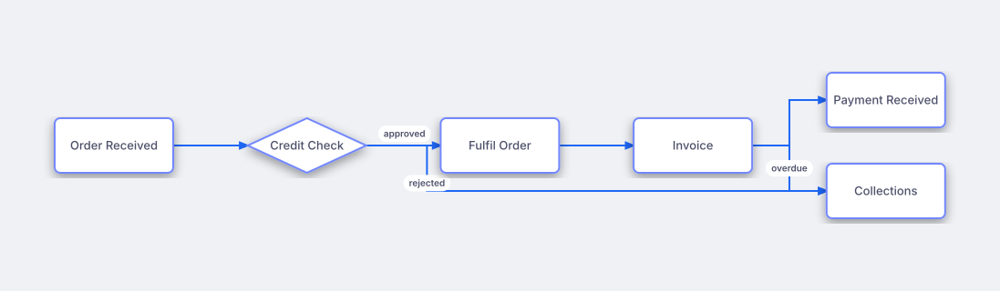

# Auto-Laid-Out Order to Cash

## Bill of Materials

| Symbol / ID | Label | Kind | Group | Technical Notes / Metadata |
| :--- | :--- | :--- | :--- | :--- |
| `shape_1` | **Order Received** | box | - | - |
| `shape_2` | **Credit Check** | diamond | - | - |
| `shape_3` | **Fulfil Order** | box | - | - |
| `shape_4` | **Invoice** | box | - | - |
| `shape_5` | **Payment Received** | box | - | - |
| `shape_6` | **Collections** | box | - | - |

## Connections

| Source | Target | Protocol / Label | Style | Routing |
| :--- | :--- | :--- | :--- | :--- |
| **Order Received** (`shape_1`) | **Credit Check** (`shape_2`) | - | solid | orthogonal |
| **Credit Check** (`shape_2`) | **Fulfil Order** (`shape_3`) | approved | solid | orthogonal |
| **Credit Check** (`shape_2`) | **Collections** (`shape_6`) | rejected | solid | orthogonal |
| **Fulfil Order** (`shape_3`) | **Invoice** (`shape_4`) | - | solid | orthogonal |
| **Invoice** (`shape_4`) | **Payment Received** (`shape_5`) | - | solid | orthogonal |
| **Invoice** (`shape_4`) | **Collections** (`shape_6`) | overdue | solid | orthogonal |
