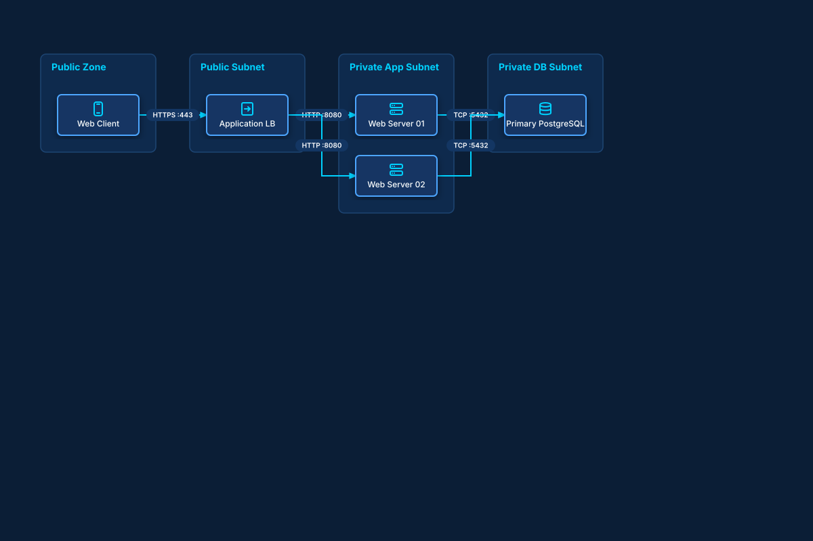

# Simple VPC Web Application

## Bill of Materials

| Symbol / ID | Label | Kind | Group | Technical Notes / Metadata |
| :--- | :--- | :--- | :--- | :--- |
| `client` | **Web Client** | box | Public Zone | type: Mobile/Browser |
| `alb` | **Application LB** | box | Public Subnet | layer: Layer 7, protocol: HTTPS |
| `web1` | **Web Server 01** | box | Private App Subnet | cpu: 2 vCPU, mem: 4GB |
| `web2` | **Web Server 02** | box | Private App Subnet | cpu: 2 vCPU, mem: 4GB |
| `db` | **Primary PostgreSQL** | box | Private DB Subnet | engine: PostgreSQL 16, ha: Multi-AZ |

## Connections

| Source | Target | Protocol / Label | Style | Routing |
| :--- | :--- | :--- | :--- | :--- |
| **Web Client** (`client`) | **Application LB** (`alb`) | HTTPS :443 | solid | orthogonal |
| **Application LB** (`alb`) | **Web Server 01** (`web1`) | HTTP :8080 | solid | orthogonal |
| **Application LB** (`alb`) | **Web Server 02** (`web2`) | HTTP :8080 | solid | orthogonal |
| **Web Server 01** (`web1`) | **Primary PostgreSQL** (`db`) | TCP :5432 | solid | orthogonal |
| **Web Server 02** (`web2`) | **Primary PostgreSQL** (`db`) | TCP :5432 | solid | orthogonal |
