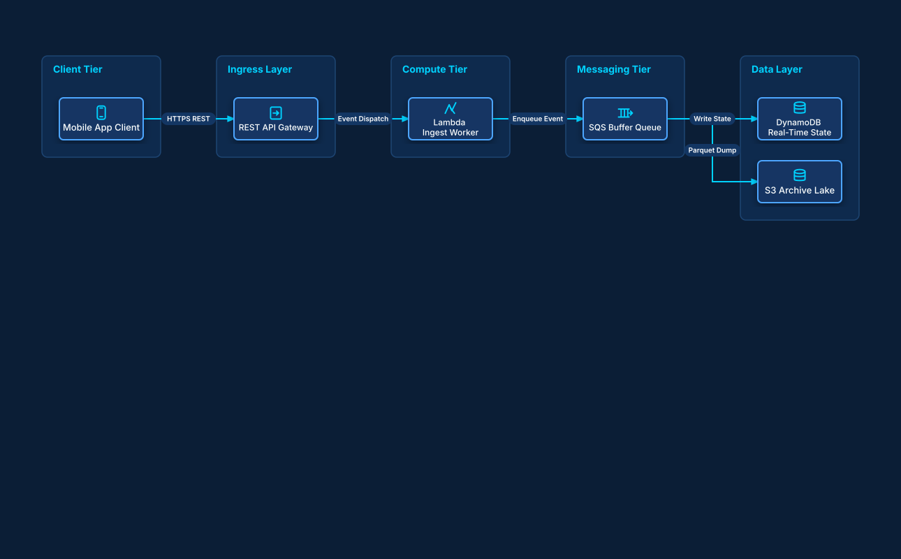

# Serverless Event Processing Pipeline

## Bill of Materials

| Symbol / ID | Label | Kind | Group | Technical Notes / Metadata |
| :--- | :--- | :--- | :--- | :--- |
| `app` | **Mobile App Client** | box | Client Tier | sdk: Amplify SDK |
| `apigw` | **REST API Gateway** | box | Ingress Layer | throttling: 10k req/s |
| `worker` | **Lambda Ingest Worker** | box | Compute Tier | runtime: Python 3.12 |
| `queue` | **SQS Buffer Queue** | box | Messaging Tier | retention: 14 Days |
| `dynamo` | **DynamoDB Real-Time State** | box | Data Layer | billing: On-Demand |
| `s3` | **S3 Archive Lake** | box | Data Layer | tier: Intelligent-Tiering |

## Connections

| Source | Target | Protocol / Label | Style | Routing |
| :--- | :--- | :--- | :--- | :--- |
| **Mobile App Client** (`app`) | **REST API Gateway** (`apigw`) | HTTPS REST | solid | orthogonal |
| **REST API Gateway** (`apigw`) | **Lambda Ingest Worker** (`worker`) | Event Dispatch | solid | orthogonal |
| **Lambda Ingest Worker** (`worker`) | **SQS Buffer Queue** (`queue`) | Enqueue Event | solid | orthogonal |
| **SQS Buffer Queue** (`queue`) | **DynamoDB Real-Time State** (`dynamo`) | Write State | solid | orthogonal |
| **SQS Buffer Queue** (`queue`) | **S3 Archive Lake** (`s3`) | Parquet Dump | solid | orthogonal |
