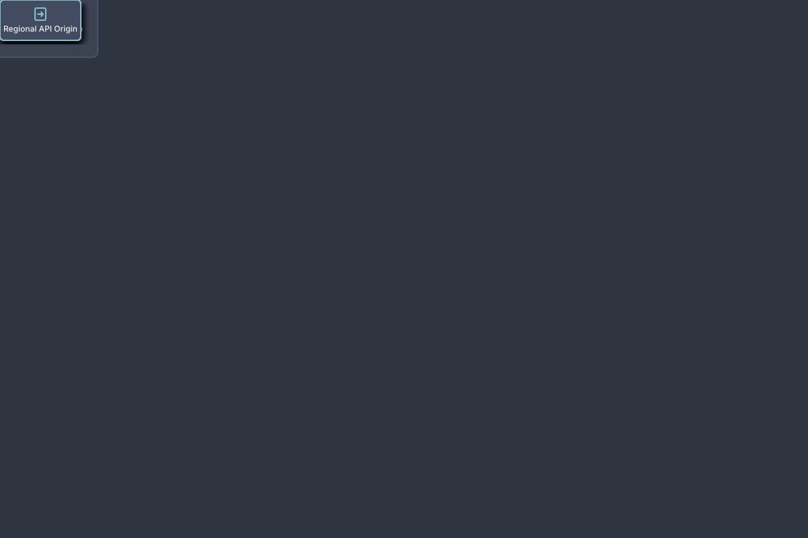

# Global Edge CDN & Origin Distribution

## Bill of Materials

| Symbol / ID | Label | Kind | Group | Technical Notes / Metadata |
| :--- | :--- | :--- | :--- | :--- |
| `user_na` | **North America Clients** | box | Global Users | latency: <15ms |
| `user_eu` | **Europe Clients** | box | Global Users | latency: <20ms |
| `dns` | **Route 53 Global DNS** | box | Routing Tier | routing: Geolocation |
| `cdn` | **CloudFront CDN Edge** | box | Edge Infrastructure | cache: TTL 86400s |
| `waf` | **AWS WAF Perimeter** | box | Edge Infrastructure | rules: OWASP Top 10 |
| `s3_static` | **S3 Static Assets** | box | Origin Tier | bucket: prod-web-assets |
| `alb_api` | **Regional API Origin** | box | Origin Tier | vpc: us-east-1 VPC |

## Connections

| Source | Target | Protocol / Label | Style | Routing |
| :--- | :--- | :--- | :--- | :--- |
| **North America Clients** (`user_na`) | **Route 53 Global DNS** (`dns`) | DNS Query | solid | orthogonal |
| **Europe Clients** (`user_eu`) | **Route 53 Global DNS** (`dns`) | DNS Query | solid | orthogonal |
| **Route 53 Global DNS** (`dns`) | **CloudFront CDN Edge** (`cdn`) | Anycast IP | solid | orthogonal |
| **CloudFront CDN Edge** (`cdn`) | **AWS WAF Perimeter** (`waf`) | Filter Threats | dashed | orthogonal |
| **CloudFront CDN Edge** (`cdn`) | **S3 Static Assets** (`s3_static`) | Static Cache | solid | orthogonal |
| **CloudFront CDN Edge** (`cdn`) | **Regional API Origin** (`alb_api`) | API Forward | solid | orthogonal |
