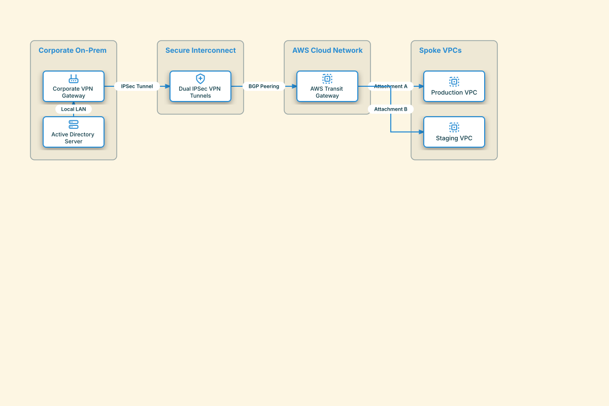

# Hybrid Cloud IPSec & Transit Gateway

## Bill of Materials

| Symbol / ID | Label | Kind | Group | Technical Notes / Metadata |
| :--- | :--- | :--- | :--- | :--- |
| `onprem_gw` | **Corporate VPN Gateway** | box | Corporate On-Prem | device: Cisco ASA |
| `onprem_srv` | **Active Directory Server** | box | Corporate On-Prem | role: Identity Provider |
| `ipsec` | **Dual IPSec VPN Tunnels** | box | Secure Interconnect | encryption: AES-256 |
| `tgw` | **AWS Transit Gateway** | box | AWS Cloud Network | asn: 64512 |
| `prod_vpc` | **Production VPC** | box | Spoke VPCs | cidr: 10.100.0.0/16 |
| `stage_vpc` | **Staging VPC** | box | Spoke VPCs | cidr: 10.200.0.0/16 |

## Connections

| Source | Target | Protocol / Label | Style | Routing |
| :--- | :--- | :--- | :--- | :--- |
| **Active Directory Server** (`onprem_srv`) | **Corporate VPN Gateway** (`onprem_gw`) | Local LAN | solid | orthogonal |
| **Corporate VPN Gateway** (`onprem_gw`) | **Dual IPSec VPN Tunnels** (`ipsec`) | IPSec Tunnel | solid | orthogonal |
| **Dual IPSec VPN Tunnels** (`ipsec`) | **AWS Transit Gateway** (`tgw`) | BGP Peering | solid | orthogonal |
| **AWS Transit Gateway** (`tgw`) | **Production VPC** (`prod_vpc`) | Attachment A | solid | orthogonal |
| **AWS Transit Gateway** (`tgw`) | **Staging VPC** (`stage_vpc`) | Attachment B | solid | orthogonal |
