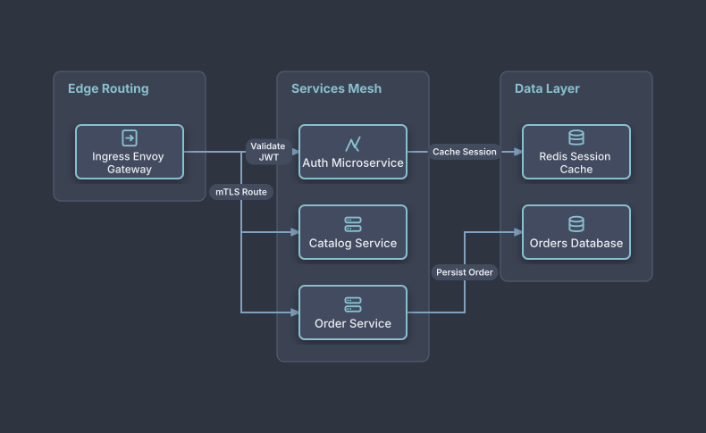

# Microservices Service Mesh Architecture

## Bill of Materials

| Symbol / ID | Label | Kind | Group | Technical Notes / Metadata |
| :--- | :--- | :--- | :--- | :--- |
| `ingress` | **Ingress Envoy Gateway** | box | Edge Routing | protocol: HTTP/2 gRPC |
| `auth_svc` | **Auth Microservice** | box | Services Mesh | framework: Go / Gin |
| `catalog_svc` | **Catalog Service** | box | Services Mesh | framework: NestJS |
| `order_svc` | **Order Service** | box | Services Mesh | framework: Spring Boot |
| `redis` | **Redis Session Cache** | box | Data Layer | cluster: Redis 7 |
| `db_orders` | **Orders Database** | box | Data Layer | engine: Aurora Postgres |

## Connections

| Source | Target | Protocol / Label | Style | Routing |
| :--- | :--- | :--- | :--- | :--- |
| **Ingress Envoy Gateway** (`ingress`) | **Auth Microservice** (`auth_svc`) | Validate JWT | solid | orthogonal |
| **Ingress Envoy Gateway** (`ingress`) | **Catalog Service** (`catalog_svc`) | mTLS Route | solid | orthogonal |
| **Ingress Envoy Gateway** (`ingress`) | **Order Service** (`order_svc`) | mTLS Route | solid | orthogonal |
| **Auth Microservice** (`auth_svc`) | **Redis Session Cache** (`redis`) | Cache Session | solid | orthogonal |
| **Order Service** (`order_svc`) | **Orders Database** (`db_orders`) | Persist Order | solid | orthogonal |
