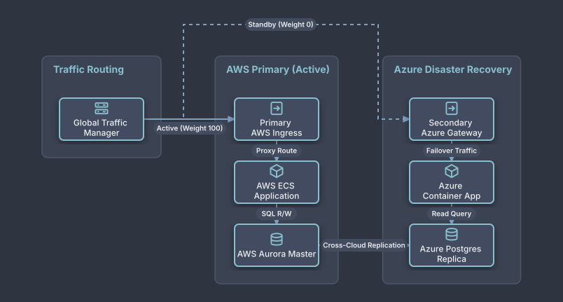

# Multi-Cloud Active-Passive Disaster Recovery

## Bill of Materials

| Symbol / ID | Label | Kind | Group | Technical Notes / Metadata |
| :--- | :--- | :--- | :--- | :--- |
| `dns_mgr` | **Global Traffic Manager** | box | Traffic Routing | check: 5s Probe |
| `aws_alb` | **Primary AWS Ingress** | box | AWS Primary (Active) | region: us-east-1 |
| `aws_app` | **AWS ECS Application** | box | AWS Primary (Active) | platform: Fargate |
| `aws_db` | **AWS Aurora Master** | box | AWS Primary (Active) | ha: Multi-AZ |
| `azure_agw` | **Secondary Azure Gateway** | box | Azure Disaster Recovery | region: eastus2 |
| `azure_app` | **Azure Container App** | box | Azure Disaster Recovery | platform: Warm Standby |
| `azure_db` | **Azure Postgres Replica** | box | Azure Disaster Recovery | role: Read Standby |

## Connections

| Source | Target | Protocol / Label | Style | Routing |
| :--- | :--- | :--- | :--- | :--- |
| **Global Traffic Manager** (`dns_mgr`) | **Primary AWS Ingress** (`aws_alb`) | Active (Weight 100) | solid | orthogonal |
| **Global Traffic Manager** (`dns_mgr`) | **Secondary Azure Gateway** (`azure_agw`) | Standby (Weight 0) | dashed | orthogonal |
| **Primary AWS Ingress** (`aws_alb`) | **AWS ECS Application** (`aws_app`) | Proxy Route | solid | orthogonal |
| **AWS ECS Application** (`aws_app`) | **AWS Aurora Master** (`aws_db`) | SQL R/W | solid | orthogonal |
| **Secondary Azure Gateway** (`azure_agw`) | **Azure Container App** (`azure_app`) | Failover Traffic | dashed | orthogonal |
| **Azure Container App** (`azure_app`) | **Azure Postgres Replica** (`azure_db`) | Read Query | dashed | orthogonal |
| **AWS Aurora Master** (`aws_db`) | **Azure Postgres Replica** (`azure_db`) | Cross-Cloud Replication | dotted | orthogonal |
