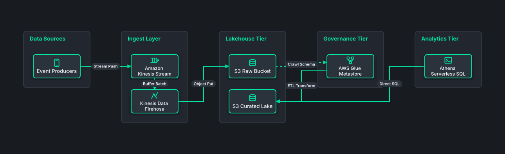

# Enterprise Cloud Data Lakehouse Ingest

## Bill of Materials

| Symbol / ID | Label | Kind | Group | Technical Notes / Metadata |
| :--- | :--- | :--- | :--- | :--- |
| `producers` | **Event Producers** | box | Data Sources | protocol: HTTPS Webhooks |
| `kinesis` | **Amazon Kinesis Stream** | box | Ingest Layer | shards: 16 Shards |
| `firehose` | **Kinesis Data Firehose** | box | Ingest Layer | buffer: 5MB/300s |
| `s3_raw` | **S3 Raw Bucket** | box | Lakehouse Tier | format: JSON Gzip |
| `s3_curated` | **S3 Curated Lake** | box | Lakehouse Tier | format: Snappy Parquet |
| `glue` | **AWS Glue Metastore** | box | Governance Tier | catalog: Iceberg |
| `athena` | **Athena Serverless SQL** | box | Analytics Tier | engine: Trino SQL |

## Connections

| Source | Target | Protocol / Label | Style | Routing |
| :--- | :--- | :--- | :--- | :--- |
| **Event Producers** (`producers`) | **Amazon Kinesis Stream** (`kinesis`) | Stream Push | solid | orthogonal |
| **Amazon Kinesis Stream** (`kinesis`) | **Kinesis Data Firehose** (`firehose`) | Buffer Batch | solid | orthogonal |
| **Kinesis Data Firehose** (`firehose`) | **S3 Raw Bucket** (`s3_raw`) | Object Put | solid | orthogonal |
| **S3 Raw Bucket** (`s3_raw`) | **AWS Glue Metastore** (`glue`) | Crawl Schema | dashed | orthogonal |
| **AWS Glue Metastore** (`glue`) | **S3 Curated Lake** (`s3_curated`) | ETL Transform | solid | orthogonal |
| **Athena Serverless SQL** (`athena`) | **S3 Curated Lake** (`s3_curated`) | Direct SQL | solid | orthogonal |
