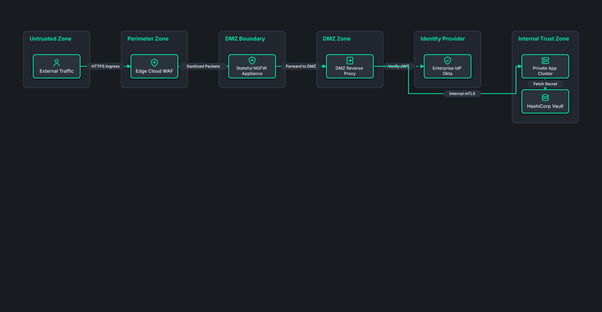

# Zero-Trust Perimeter & DMZ Security Ingress

## Bill of Materials

| Symbol / ID | Label | Kind | Group | Technical Notes / Metadata |
| :--- | :--- | :--- | :--- | :--- |
| `internet` | **External Traffic** | box | Untrusted Zone | origin: Public Internet |
| `waf` | **Edge Cloud WAF** | box | Perimeter Zone | ddos: L3-L7 Defense |
| `fw_app` | **Stateful NGFW Appliance** | box | DMZ Boundary | ips: Snort Engine |
| `dmz_proxy` | **DMZ Reverse Proxy** | box | DMZ Zone | tls: Terminate mTLS |
| `auth_idp` | **Enterprise IdP Okta** | box | Identity Provider | mfa: FIDO2 |
| `backend` | **Private App Cluster** | box | Internal Trust Zone | subnet: 10.0.10.0/24 |
| `vault` | **HashiCorp Vault** | box | Internal Trust Zone | keys: Hardware HSM |

## Connections

| Source | Target | Protocol / Label | Style | Routing |
| :--- | :--- | :--- | :--- | :--- |
| **External Traffic** (`internet`) | **Edge Cloud WAF** (`waf`) | HTTPS Ingress | solid | orthogonal |
| **Edge Cloud WAF** (`waf`) | **Stateful NGFW Appliance** (`fw_app`) | Sanitized Packets | solid | orthogonal |
| **Stateful NGFW Appliance** (`fw_app`) | **DMZ Reverse Proxy** (`dmz_proxy`) | Forward to DMZ | solid | orthogonal |
| **DMZ Reverse Proxy** (`dmz_proxy`) | **Enterprise IdP Okta** (`auth_idp`) | Verify JWT | dashed | orthogonal |
| **DMZ Reverse Proxy** (`dmz_proxy`) | **Private App Cluster** (`backend`) | Internal mTLS | solid | orthogonal |
| **Private App Cluster** (`backend`) | **HashiCorp Vault** (`vault`) | Fetch Secret | dashed | orthogonal |
