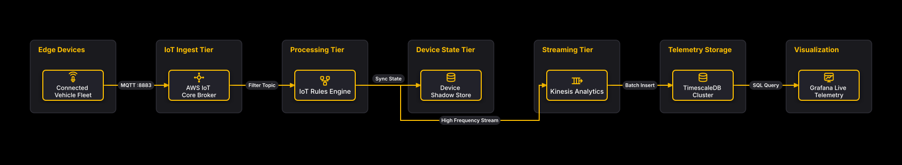

# Cloud IoT Fleet Telemetry & Management

## Bill of Materials

| Symbol / ID | Label | Kind | Group | Technical Notes / Metadata |
| :--- | :--- | :--- | :--- | :--- |
| `fleet` | **Connected Vehicle Fleet** | box | Edge Devices | units: 100k Vehicles |
| `iot_core` | **AWS IoT Core Broker** | box | IoT Ingest Tier | protocol: MQTT v5 |
| `rules` | **IoT Rules Engine** | box | Processing Tier | filter: SQL Evaluation |
| `shadow` | **Device Shadow Store** | box | Device State Tier | format: JSON Delta |
| `kinesis` | **Kinesis Analytics** | box | Streaming Tier | window: 10s Tumbling |
| `timescale` | **TimescaleDB Cluster** | box | Telemetry Storage | hypertables: Compressed |
| `dash` | **Grafana Live Telemetry** | box | Visualization | refresh: 1s Stream |

## Connections

| Source | Target | Protocol / Label | Style | Routing |
| :--- | :--- | :--- | :--- | :--- |
| **Connected Vehicle Fleet** (`fleet`) | **AWS IoT Core Broker** (`iot_core`) | MQTT :8883 | solid | orthogonal |
| **AWS IoT Core Broker** (`iot_core`) | **IoT Rules Engine** (`rules`) | Filter Topic | solid | orthogonal |
| **IoT Rules Engine** (`rules`) | **Device Shadow Store** (`shadow`) | Sync State | solid | orthogonal |
| **IoT Rules Engine** (`rules`) | **Kinesis Analytics** (`kinesis`) | High Frequency Stream | solid | orthogonal |
| **Kinesis Analytics** (`kinesis`) | **TimescaleDB Cluster** (`timescale`) | Batch Insert | solid | orthogonal |
| **TimescaleDB Cluster** (`timescale`) | **Grafana Live Telemetry** (`dash`) | SQL Query | solid | orthogonal |
