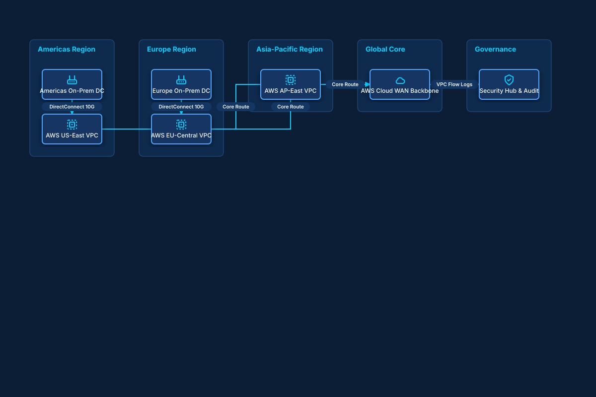

# Global Enterprise Multi-Region Network Backbone

## Bill of Materials

| Symbol / ID | Label | Kind | Group | Technical Notes / Metadata |
| :--- | :--- | :--- | :--- | :--- |
| `us_dc` | **Americas On-Prem DC** | box | Americas Region | location: Chicago, IL |
| `us_vpc` | **AWS US-East VPC** | box | Americas Region | cidr: 10.10.0.0/16 |
| `eu_dc` | **Europe On-Prem DC** | box | Europe Region | location: Frankfurt, DE |
| `eu_vpc` | **AWS EU-Central VPC** | box | Europe Region | cidr: 10.20.0.0/16 |
| `ap_vpc` | **AWS AP-East VPC** | box | Asia-Pacific Region | cidr: 10.30.0.0/16 |
| `cloud_wan` | **AWS Cloud WAN Backbone** | box | Global Core | bgp: ASN 64512 |
| `sec_hub` | **Security Hub & Audit** | box | Governance | audit: Real-Time CIS |

## Connections

| Source | Target | Protocol / Label | Style | Routing |
| :--- | :--- | :--- | :--- | :--- |
| **Americas On-Prem DC** (`us_dc`) | **AWS US-East VPC** (`us_vpc`) | DirectConnect 10G | solid | orthogonal |
| **Europe On-Prem DC** (`eu_dc`) | **AWS EU-Central VPC** (`eu_vpc`) | DirectConnect 10G | solid | orthogonal |
| **AWS US-East VPC** (`us_vpc`) | **AWS Cloud WAN Backbone** (`cloud_wan`) | Core Route | solid | orthogonal |
| **AWS EU-Central VPC** (`eu_vpc`) | **AWS Cloud WAN Backbone** (`cloud_wan`) | Core Route | solid | orthogonal |
| **AWS AP-East VPC** (`ap_vpc`) | **AWS Cloud WAN Backbone** (`cloud_wan`) | Core Route | solid | orthogonal |
| **AWS Cloud WAN Backbone** (`cloud_wan`) | **Security Hub & Audit** (`sec_hub`) | VPC Flow Logs | dashed | orthogonal |
