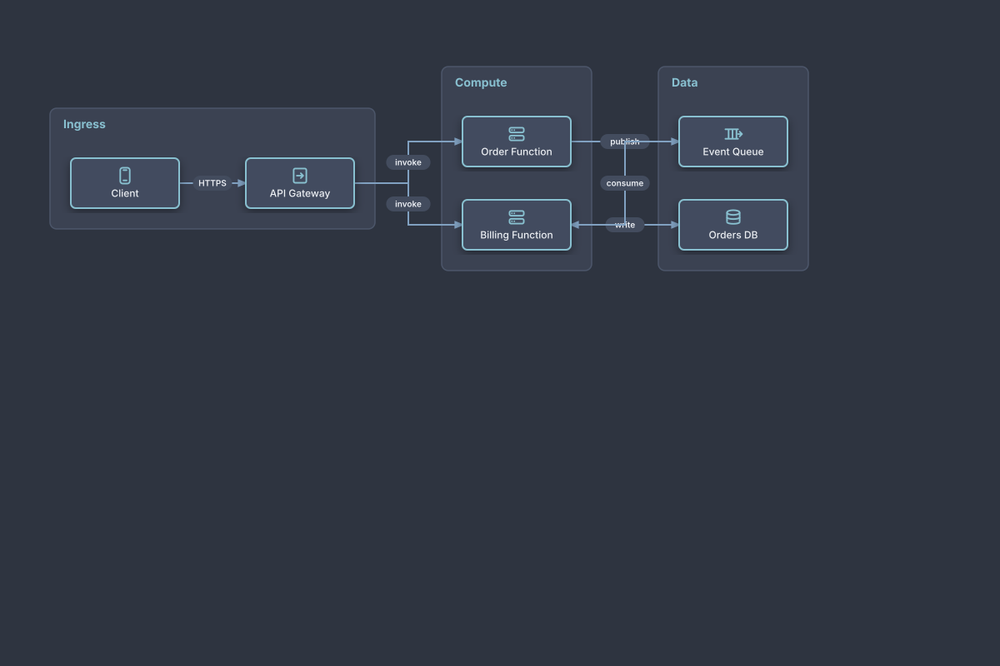

# Auto-Laid-Out Serverless Pipeline

## Bill of Materials

| Symbol / ID | Label | Kind | Group | Technical Notes / Metadata |
| :--- | :--- | :--- | :--- | :--- |
| `shape_2` | **Client** | box | Ingress | - |
| `shape_3` | **API Gateway** | box | Ingress | - |
| `shape_5` | **Order Function** | box | Compute | - |
| `shape_6` | **Billing Function** | box | Compute | - |
| `shape_8` | **Event Queue** | box | Data | - |
| `shape_9` | **Orders DB** | box | Data | - |

## Connections

| Source | Target | Protocol / Label | Style | Routing |
| :--- | :--- | :--- | :--- | :--- |
| **Client** (`shape_2`) | **API Gateway** (`shape_3`) | HTTPS | solid | orthogonal |
| **API Gateway** (`shape_3`) | **Order Function** (`shape_5`) | invoke | solid | orthogonal |
| **API Gateway** (`shape_3`) | **Billing Function** (`shape_6`) | invoke | solid | orthogonal |
| **Order Function** (`shape_5`) | **Event Queue** (`shape_8`) | publish | solid | orthogonal |
| **Billing Function** (`shape_6`) | **Orders DB** (`shape_9`) | write | solid | orthogonal |
| **Event Queue** (`shape_8`) | **Billing Function** (`shape_6`) | consume | solid | orthogonal |
