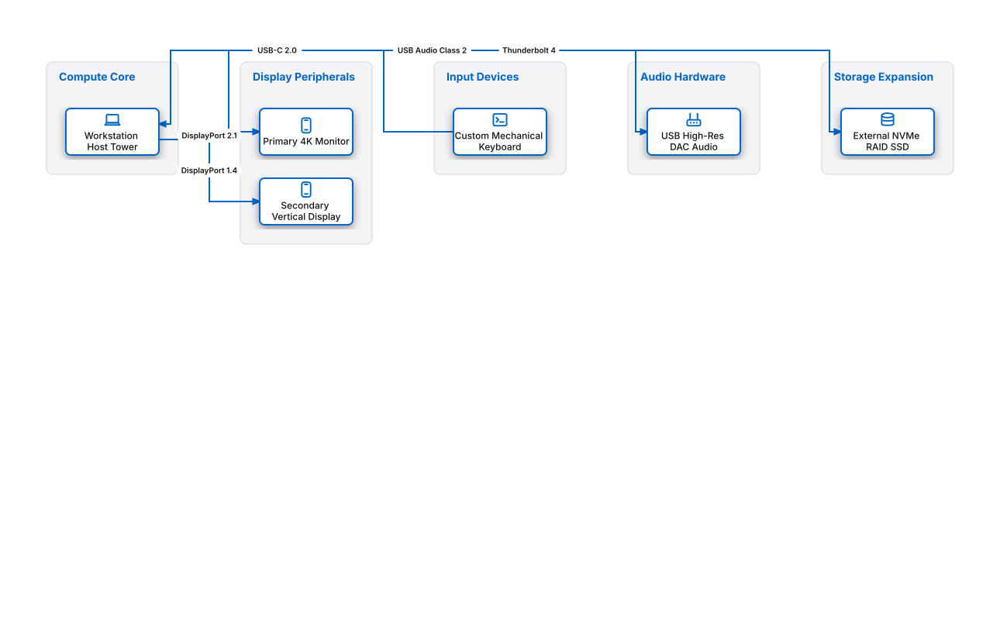

# Professional Workstation Hardware Topology

## Bill of Materials

| Symbol / ID | Label | Kind | Group | Technical Notes / Metadata |
| :--- | :--- | :--- | :--- | :--- |
| `pc_host` | **Workstation Host Tower** | box | Compute Core | cpu: AMD Ryzen 9 7950X, ram: 64GB DDR5 |
| `display1` | **Primary 4K Monitor** | box | Display Peripherals | resolution: 3840x2160 @ 144Hz |
| `display2` | **Secondary Vertical Display** | box | Display Peripherals | resolution: 2160x3840 @ 60Hz |
| `keyboard` | **Custom Mechanical Keyboard** | box | Input Devices | switch: Hot-Swap Mechanical |
| `dac` | **USB High-Res DAC Audio** | box | Audio Hardware | sample: 32-bit / 384kHz |
| `backup_ssd` | **External NVMe RAID SSD** | box | Storage Expansion | interface: Thunderbolt 4 40Gbps |

## Connections

| Source | Target | Protocol / Label | Style | Routing |
| :--- | :--- | :--- | :--- | :--- |
| **Workstation Host Tower** (`pc_host`) | **Primary 4K Monitor** (`display1`) | DisplayPort 2.1 | solid | orthogonal |
| **Workstation Host Tower** (`pc_host`) | **Secondary Vertical Display** (`display2`) | DisplayPort 1.4 | solid | orthogonal |
| **Custom Mechanical Keyboard** (`keyboard`) | **Workstation Host Tower** (`pc_host`) | USB-C 2.0 | solid | orthogonal |
| **Workstation Host Tower** (`pc_host`) | **USB High-Res DAC Audio** (`dac`) | USB Audio Class 2 | solid | orthogonal |
| **Workstation Host Tower** (`pc_host`) | **External NVMe RAID SSD** (`backup_ssd`) | Thunderbolt 4 | solid | orthogonal |
