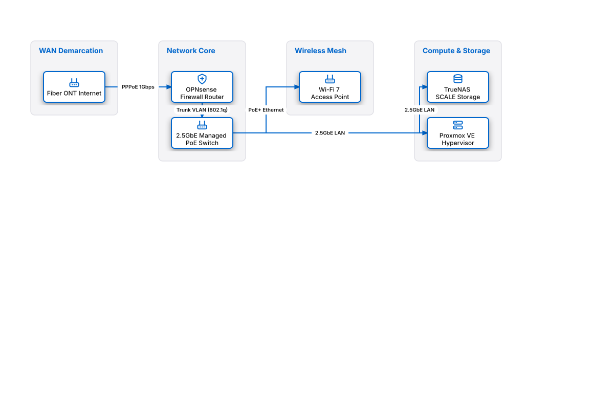

# Home Lab Self-Hosted Infrastructure

## Bill of Materials

| Symbol / ID | Label | Kind | Group | Technical Notes / Metadata |
| :--- | :--- | :--- | :--- | :--- |
| `ont` | **Fiber ONT Internet** | box | WAN Demarcation | speed: 1 Gbps Symmetrical |
| `opnsense` | **OPNsense Firewall Router** | box | Network Core | hardware: Intel N100 4x2.5GbE |
| `poe_switch` | **2.5GbE Managed PoE Switch** | box | Network Core | ports: 8-Port PoE+ 2.5G |
| `ap_wifi` | **Wi-Fi 7 Access Point** | box | Wireless Mesh | ssids: Trusted, IoT, Guest |
| `truenas` | **TrueNAS SCALE Storage** | box | Compute & Storage | zpool: 4x 16TB ZFS RAIDZ2 |
| `proxmox` | **Proxmox VE Hypervisor** | box | Compute & Storage | vms: Home Assistant, AdGuard, Plex |

## Connections

| Source | Target | Protocol / Label | Style | Routing |
| :--- | :--- | :--- | :--- | :--- |
| **Fiber ONT Internet** (`ont`) | **OPNsense Firewall Router** (`opnsense`) | PPPoE 1Gbps | solid | orthogonal |
| **OPNsense Firewall Router** (`opnsense`) | **2.5GbE Managed PoE Switch** (`poe_switch`) | Trunk VLAN (802.1q) | solid | orthogonal |
| **2.5GbE Managed PoE Switch** (`poe_switch`) | **Wi-Fi 7 Access Point** (`ap_wifi`) | PoE+ Ethernet | solid | orthogonal |
| **2.5GbE Managed PoE Switch** (`poe_switch`) | **TrueNAS SCALE Storage** (`truenas`) | 2.5GbE LAN | solid | orthogonal |
| **2.5GbE Managed PoE Switch** (`poe_switch`) | **Proxmox VE Hypervisor** (`proxmox`) | 2.5GbE LAN | solid | orthogonal |
