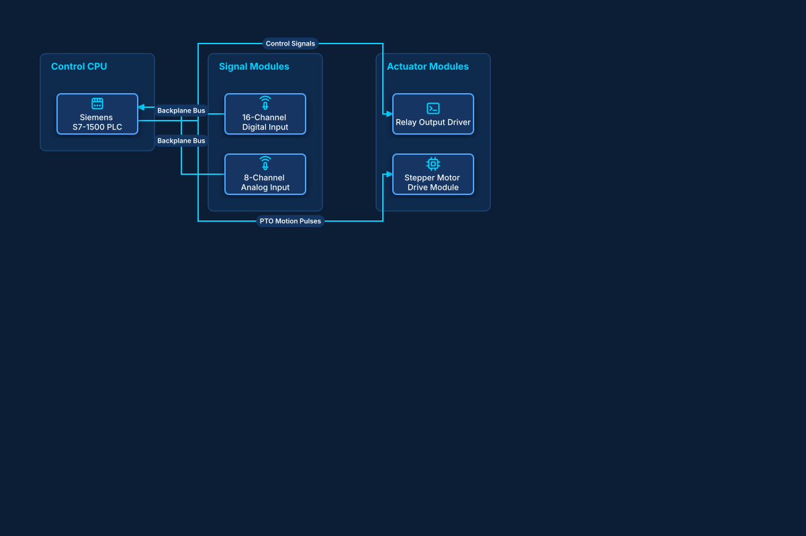

# Industrial PLC Hardware & IO Subsystem

## Bill of Materials

| Symbol / ID | Label | Kind | Group | Technical Notes / Metadata |
| :--- | :--- | :--- | :--- | :--- |
| `plc_cpu` | **Siemens S7-1500 PLC** | box | Control CPU | firmware: v3.1, cycle: 2ms Scan |
| `di_module` | **16-Channel Digital Input** | box | Signal Modules | voltage: 24V DC Optical Isolation |
| `ai_module` | **8-Channel Analog Input** | box | Signal Modules | signal: 4-20mA / 0-10V |
| `relay_out` | **Relay Output Driver** | box | Actuator Modules | rating: 250V AC 5A |
| `stepper` | **Stepper Motor Drive Module** | box | Actuator Modules | protocol: Pulse / Direction 200kHz |

## Connections

| Source | Target | Protocol / Label | Style | Routing |
| :--- | :--- | :--- | :--- | :--- |
| **16-Channel Digital Input** (`di_module`) | **Siemens S7-1500 PLC** (`plc_cpu`) | Backplane Bus | solid | orthogonal |
| **8-Channel Analog Input** (`ai_module`) | **Siemens S7-1500 PLC** (`plc_cpu`) | Backplane Bus | solid | orthogonal |
| **Siemens S7-1500 PLC** (`plc_cpu`) | **Relay Output Driver** (`relay_out`) | Control Signals | solid | orthogonal |
| **Siemens S7-1500 PLC** (`plc_cpu`) | **Stepper Motor Drive Module** (`stepper`) | PTO Motion Pulses | solid | orthogonal |
