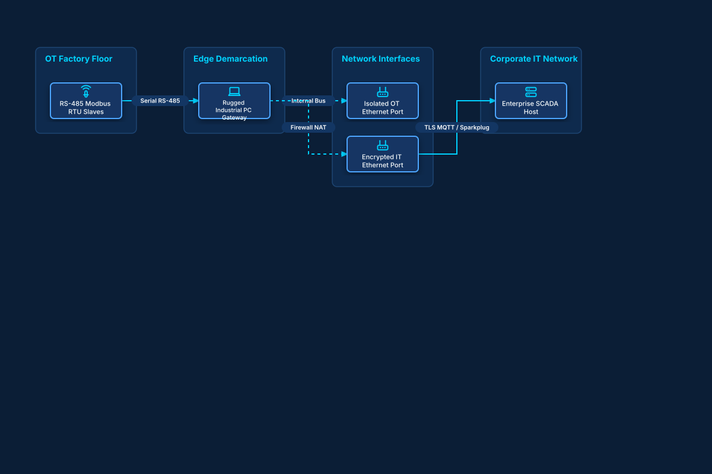

# Dual-Homed Industrial Edge Gateway

## Bill of Materials

| Symbol / ID | Label | Kind | Group | Technical Notes / Metadata |
| :--- | :--- | :--- | :--- | :--- |
| `field_sensors` | **RS-485 Modbus RTU Slaves** | box | OT Factory Floor | baud: 115200 bps |
| `edge_ipc` | **Rugged Industrial PC Gateway** | box | Edge Demarcation | os: Debian Linux Real-Time |
| `ot_nic` | **Isolated OT Ethernet Port** | box | Network Interfaces | ip: 192.168.100.1 (Airgapped) |
| `it_nic` | **Encrypted IT Ethernet Port** | box | Network Interfaces | ip: 10.0.50.25 (Corporate LAN) |
| `corp_server` | **Enterprise SCADA Host** | box | Corporate IT Network | database: PostgreSQL Timescale |

## Connections

| Source | Target | Protocol / Label | Style | Routing |
| :--- | :--- | :--- | :--- | :--- |
| **RS-485 Modbus RTU Slaves** (`field_sensors`) | **Rugged Industrial PC Gateway** (`edge_ipc`) | Serial RS-485 | solid | orthogonal |
| **Rugged Industrial PC Gateway** (`edge_ipc`) | **Isolated OT Ethernet Port** (`ot_nic`) | Internal Bus | dashed | orthogonal |
| **Rugged Industrial PC Gateway** (`edge_ipc`) | **Encrypted IT Ethernet Port** (`it_nic`) | Firewall NAT | dashed | orthogonal |
| **Encrypted IT Ethernet Port** (`it_nic`) | **Enterprise SCADA Host** (`corp_server`) | TLS MQTT / Sparkplug | solid | orthogonal |
