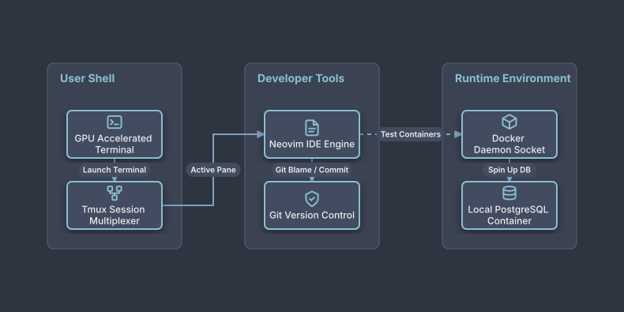

# Modern Developer Terminal Toolchain

## Bill of Materials

| Symbol / ID | Label | Kind | Group | Technical Notes / Metadata |
| :--- | :--- | :--- | :--- | :--- |
| `terminal` | **GPU Accelerated Terminal** | box | User Shell | emulator: Alacritty / WezTerm |
| `tmux` | **Tmux Session Multiplexer** | box | User Shell | panes: Dev / Logs / Build |
| `neovim` | **Neovim IDE Engine** | box | Developer Tools | lsp: Pyright / Rust-Analyzer |
| `git_daemon` | **Git Version Control** | box | Developer Tools | signing: SSH Key Signed |
| `docker_sock` | **Docker Daemon Socket** | box | Runtime Environment | socket: /var/run/docker.sock |
| `local_db` | **Local PostgreSQL Container** | box | Runtime Environment | port: 5432 |

## Connections

| Source | Target | Protocol / Label | Style | Routing |
| :--- | :--- | :--- | :--- | :--- |
| **GPU Accelerated Terminal** (`terminal`) | **Tmux Session Multiplexer** (`tmux`) | Launch Terminal | solid | orthogonal |
| **Tmux Session Multiplexer** (`tmux`) | **Neovim IDE Engine** (`neovim`) | Active Pane | solid | orthogonal |
| **Neovim IDE Engine** (`neovim`) | **Git Version Control** (`git_daemon`) | Git Blame / Commit | dashed | orthogonal |
| **Neovim IDE Engine** (`neovim`) | **Docker Daemon Socket** (`docker_sock`) | Test Containers | dashed | orthogonal |
| **Docker Daemon Socket** (`docker_sock`) | **Local PostgreSQL Container** (`local_db`) | Spin Up DB | solid | orthogonal |
