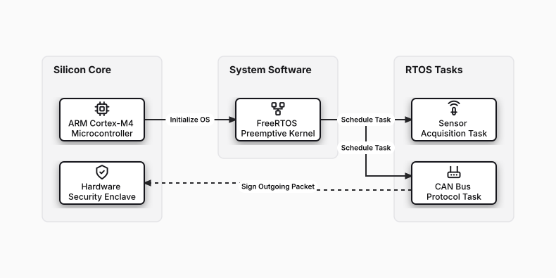

# Embedded Real-Time Operating System (RTOS)

## Bill of Materials

| Symbol / ID | Label | Kind | Group | Technical Notes / Metadata |
| :--- | :--- | :--- | :--- | :--- |
| `arm_mcu` | **ARM Cortex-M4 Microcontroller** | box | Silicon Core | clock: 168 MHz, flash: 1MB |
| `crypto` | **Hardware Security Enclave** | box | Silicon Core | features: Secure Boot / True RNG |
| `freertos` | **FreeRTOS Preemptive Kernel** | box | System Software | tick: 1ms SysTick |
| `task_sensor` | **Sensor Acquisition Task** | box | RTOS Tasks | priority: High (Level 3) |
| `task_comms` | **CAN Bus Protocol Task** | box | RTOS Tasks | priority: Medium (Level 2) |

## Connections

| Source | Target | Protocol / Label | Style | Routing |
| :--- | :--- | :--- | :--- | :--- |
| **ARM Cortex-M4 Microcontroller** (`arm_mcu`) | **FreeRTOS Preemptive Kernel** (`freertos`) | Initialize OS | solid | orthogonal |
| **FreeRTOS Preemptive Kernel** (`freertos`) | **Sensor Acquisition Task** (`task_sensor`) | Schedule Task | solid | orthogonal |
| **FreeRTOS Preemptive Kernel** (`freertos`) | **CAN Bus Protocol Task** (`task_comms`) | Schedule Task | solid | orthogonal |
| **CAN Bus Protocol Task** (`task_comms`) | **Hardware Security Enclave** (`crypto`) | Sign Outgoing Packet | dashed | orthogonal |
